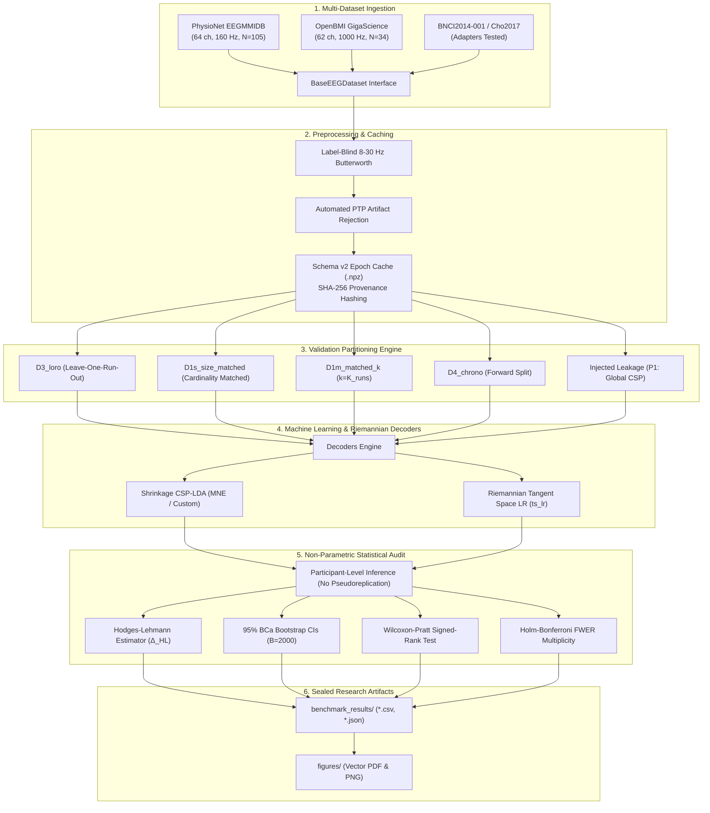

# LeakCheck: EEG Validation Design & Data Leakage Auditing Benchmark

[](tests/)
[](pyproject.toml)
[](LICENSE)
[](docs/reproducibility.md)
[](docs/datasets.md)

**LeakCheck** is a scientific Python framework and empirical benchmarking suite for auditing validation design, data leakage, and statistical reproducibility in electroencephalography (EEG) machine learning and brain-computer interfaces (BCIs).

---

## Table of Contents
1. [Project Overview](#1-project-overview)
2. [Why EEG Data Leakage Matters](#2-why-eeg-data-leakage-matters)
3. [Research Motivation & Problem Statement](#3-research-motivation--problem-statement)
4. [Scientific Objectives](#4-scientific-objectives)
5. [Key Contributions & Novel Findings](#5-key-contributions--novel-findings)
6. [System Architecture](#6-system-architecture)
7. [Supported EEG Datasets](#7-supported-eeg-datasets)
8. [Leakage Taxonomy & Mechanisms (P1–P9)](#8-leakage-taxonomy--mechanisms-p1p9)
9. [Supported Validation Designs (D1–D6)](#9-supported-validation-designs-d1d6)
10. [Supported Decoders](#10-supported-decoders)
11. [Statistical Methods & Inference](#11-statistical-methods--inference)
12. [Verified Empirical Benchmark Results](#12-verified-empirical-benchmark-results)
13. [Installation Guide](#13-installation-guide)
14. [Environment Setup](#14-environment-setup)
15. [Quick-Start Demonstration](#15-quick-start-demonstration)
16. [Dataset Preparation & Ingestion](#16-dataset-preparation--ingestion)
17. [How to Run Audits & Benchmarks](#17-how-to-run-audits--benchmarks)
18. [How to Reproduce Published Results](#18-how-to-reproduce-published-results)
19. [Output Artifacts & Interpretation](#19-output-artifacts--interpretation)
20. [Repository Structure](#20-repository-structure)
21. [Automated Testing & Continuous Integration](#21-automated-testing--continuous-integration)
22. [Known Limitations & Roadmap Boundaries](#22-known-limitations--roadmap-boundaries)
23. [Citation & References](#23-citation--references)
24. [License](#24-license)
25. [Contributing Guidelines](#25-contributing-guidelines)
26. [Contact & Governance](#26-contact--governance)
27. [Documentation Directory Map](#27-documentation-directory-map)

---

## 1. Project Overview

LeakCheck (Python package: `emi`) provides computational neuroscientists and machine learning researchers with deterministic tools to detect, quantify, and prevent methodological data leakage in EEG decoding. 

By comparing clean operational benchmarks (e.g. Leave-One-Run-Out cross-validation, $D_3$) against naive pooled partitions ($D_1, D_{1s}$) and controlled leakage injections ($P_1\text{--}P_9$), LeakCheck isolates the exact statistical magnitude and directionality of validation biases across multi-channel neuroimaging cohorts.

---

## 2. Why EEG Data Leakage Matters

In biomedical machine learning and neurotechnology, reported classification accuracies often fail to translate to clinical or real-time deployment. In EEG and BCI literature, this performance collapse is largely driven by **methodological data leakage**:
- **Temporal Autocorrelation**: Slicing continuous, bandpass-filtered signals into overlapping epochs before cross-validation allows contiguous samples to leak across train/test splits.
- **Supervised Spatial Snooping**: Common Spatial Pattern (CSP) filters or supervised feature selectors fitted on pooled data use test-set class labels, producing near-perfect classification on pure white noise.
- **Inter-Run Non-Stationarity**: Standard random $k$-fold cross-validation shuffles trials across recording runs, obscuring slow electrode impedance changes and baseline drift that real-time decoders face.

LeakCheck provides the open-source auditing foundation to eliminate these flaws prior to publication.

---

## 3. Research Motivation & Problem Statement

Prior literature contained conflicting claims regarding whether random trial shuffling ($D_1$) systematically inflates or deflates cross-validation accuracy relative to clean leave-one-run-out ($D_3$). Many authors hypothesized that apparent performance differences were merely artifacts of unequal training fold sizes.

LeakCheck was designed to answer two central questions:
1. **The Cardinality Hypothesis**: Does random trial shuffling distort performance even when fold sizes and per-class trial counts strictly match clean run-level cross-validation ($D_{1s}$)?
2. **The Contamination Dominance Hypothesis**: Does supervised spatial filter leakage ($P_1$) overwhelm partition-level validation effects, and are Riemannian geometry decoders mathematically immune to this contamination?

---

## 4. Scientific Objectives

1. **Rigorous Verification**: Provide an end-to-end, mathematically verified auditing pipeline that guarantees zero training/test set index overlap.
2. **Cardinality-Controlled Benchmarking**: Benchmark size- and class-matched random splitting ($D_{1s}$) against LORO ($D_3$) across large, multi-session public cohorts.
3. **Multi-Dataset Generalization**: Extend auditing beyond a single corpus by benchmarking both PhysioNet EEGMMIDB ($N=105$) and OpenBMI ($N=34$).
4. **Decoder Resilience Analysis**: Compare the susceptibility of spatial filtering pipelines (CSP-LDA) versus Riemannian manifold geometry (`ts_lr`).
5. **Open Science Standards**: Formalize the EEG Benchmark Registry schemas (`registry/schemas/`) for open meta-analyses.

---

## 5. Key Contributions & Novel Findings

1. **Deflation Under Stationary Drift**: Across $N=105$ participants of PhysioNet EEGMMIDB, size-matched trial shuffling ($D_{1s}$) produces a statistically significant **$-2.68$ pp deflation** relative to clean LORO ($p = 5.86 \times 10^{-5}$), disproving the assumption that trial shuffling universally inflates accuracy.
2. **Regime-Dependent Directionality**: On the OpenBMI cohort ($N=34$), where Run 0 (offline screening) and Run 1 (online feedback) represent qualitatively distinct operational states, trial pooling produces an **inflation of $+2.84$ pp** ($p = 1.87 \times 10^{-4}$). The direction of partition bias is determined by whether the recording blocks exhibit sensor drift (forcing noisy interpolation) or regime shifts (allowing interpolation to bypass calibration).
3. **Refutation of Riemannian Spatial Immunity**: On the full $N=34$ OpenBMI cohort, Riemannian Tangent Space Logistic Regression (`ts_lr`) exhibits a small but statistically significant **$+0.75$ pp shift** ($p = 0.0203$) under $P_1$. While not mathematically immune (due to slight Fréchet reference point shifts), TS-LR is over **$8\times$ more resilient** than CSP-LDA ($+6.25$ pp).
4. **Dominance of Supervised Spatial Snooping**: Fitting CSP globally on all data produces an overwhelming **$+24.50$ pp artificial inflation** on PhysioNet ($d_z = 1.771$), demonstrating that spatial filter leakage completely dwarfs partition effects.

---

## 6. System Architecture



For complete architectural contracts and Cordis-style seams, see [docs/architecture.md](docs/architecture.md).

---

## 7. Supported EEG Datasets

| Dataset | Cohort Size | Channels | Sampling Rate | Paradigm | Status |
|---|---|---|---|---|---|
| **PhysioNet EEGMMIDB** | 109 ($N=105$ analyzed) | 64 EEG | 160 Hz | Left vs Right Fist MI (Runs 4, 8, 12) | **Tier 1 (V1.1 Gold Standard)** |
| **OpenBMI (Lee et al. 2019)** | 54 ($N=34$ verified intact) | 62 EEG | 1000 Hz $\to$ 160 Hz | Left vs Right Hand MI (Session 1, Runs 0 & 1) | **Tier 1 (V2 Benchmark)** |
| **BNCI2014-001 (BCI IV-2a)** | 9 | 22 EEG | 250 Hz | 4-class Motor Imagery | **Tier 2 (Adapter Verified)** |
| **Cho et al. (2017)** | 52 | 64 EEG | 512 Hz | Left vs Right Hand MI | **Tier 2 (Adapter Verified)** |

Detailed descriptions, exclusion rationales, and BIDS compatibility are documented in [docs/datasets.md](docs/datasets.md).

---

## 8. Leakage Taxonomy & Mechanisms (P1–P9)

| Mechanism | Description | Contamination Pathway | Status |
|---|---|---|---|
| **P1** | **Supervised Spatial Filtering** | CSP filters computed across all trials prior to fold splitting. | **Tier 1 (Empirically Proven)** |
| **P2** | **Unsupervised Spatial Filtering** | ICA ocular unmixing fitted across concatenated runs. | **Tier 2 (Architecturally Designed)** |
| **P3** | **Temporal Filter Boundary Leakage** | Continuous bandpass filtering crossing fold boundaries. | **Tier 3 (Registry Protocol)** |
| **P4** | **Temporal Window Peeking** | Tuning post-cue time windows directly to test accuracy. | **Tier 3 (Registry Protocol)** |
| **P5** | **Global Feature Normalization** | Z-scoring features using pooled mean and variance. | **Tier 2 (Prototype Implemented)** |
| **P6** | **Hyperparameter Snooping** | Selecting regularisation parameter $C$ on test fold data. | **Tier 2 (Prototype Implemented)** |
| **P7** | **Global Feature Selection** | Ranking/selecting features via correlation with test labels. | **Tier 3 (Registry Protocol)** |
| **P8** | **Sliding Window Overlap** | Overlapping temporal windows spanning train and test sets. | **Tier 3 (Registry Protocol)** |
| **P9** | **Subject Identity Confounding** | Evaluating cross-subject models on trials from known subjects. | **Tier 3 (Registry Protocol)** |

For mathematical formulations and controls, see [docs/leakage_mechanisms.md](docs/leakage_mechanisms.md).

---

## 9. Supported Validation Designs (D1–D6)

- **`D3_loro` (Leave-One-Run-Out)**: Clean operational benchmark. Train on $K-1$ runs, test on run $k$. Complete inter-run isolation.
- **`D1s_size_matched`**: Cardinality-matched random split. Each fold matches `D3_loro` in sample size and class balance, isolating the pure trial shuffling effect.
- **`D1m_matched_k`**: Standard $k$-fold cross-validation with $k = K_{\text{runs}}$.
- **`D1_kfold`**: Naive $k$-fold cross-validation across all pooled trials.
- **`D4_chrono`**: Forward-chaining split (train on runs $1 \dots K-1$, test on run $K$).
- **`D5_within_run`**: Within-run cross-validation averaged across blocks.

Full protocol specifications are given in [docs/benchmark_protocols.md](docs/benchmark_protocols.md).

---

## 10. Supported Decoders

1. **`csp_lda` (Shrinkage CSP-LDA)**: Common Spatial Patterns with OAS covariance shrinkage followed by Linear Discriminant Analysis.
2. **`csp_lr` (CSP Logistic Regression)**: CSP spatial filtering followed by $L_2$-regularized Logistic Regression.
3. **`csp_svm` (CSP Support Vector Machine)**: CSP spatial filtering with linear SVM.
4. **`ts_lr` (Riemannian Tangent Space LR)**: Native pure-NumPy `CovarianceTransformer` and `TangentSpaceTransformer` mapping SPD matrices to the Riemannian tangent space at the Fréchet mean.
5. **`ts_lda` (Riemannian Tangent Space LDA)**: Tangent space projection coupled with shrinkage LDA.

---

## 11. Statistical Methods & Inference

To eliminate pseudoreplication, LeakCheck computes all inferential statistics strictly at the participant level ($N=105$ or $N=34$):
- **Hodges-Lehmann Estimator ($\Delta_{\text{HL}}$)**: Median of all pairwise Walsh averages: $\Delta_{\text{HL}} = \operatorname{median}_{i \le j} \frac{D_i + D_j}{2}$.
- **95% BCa Bootstrap CIs**: Bias-Corrected and Accelerated confidence intervals ($B = 2{,}000$ resamples) adjusting for bias and skewness.
- **Wilcoxon-Pratt Signed-Rank Test**: Two-sided non-parametric hypothesis testing retaining zero-difference pairs.
- **Holm-Bonferroni FWER Multiplicity Correction**: Step-down control across tested contrast families.
- **Within-Subject Effect Size ($d_z$)**: Standardized mean difference $d_z = \bar{D} / s_D$.

Complete mathematical derivations are provided in [docs/statistical_methods.md](docs/statistical_methods.md).

---

## 12. Verified Empirical Benchmark Results

### 12.1 PhysioNet EEGMMIDB Benchmark ($N = 105$, CSP-LDA)
*Evaluated across all 105 verified participants on runs 4, 8, 12 (left vs. right fist).*

| Comparison | Contrast Type | Mean Diff | Median Diff | Hodges-Lehmann ($\Delta_{\text{HL}}$) | 95% BCa Bootstrap CI | Wilcoxon $p_{\text{Holm}}$ | Cohen's $d_z$ |
|---|---|---:|---:|---:|---:|---:|---:|
| **P1 vs D3** | Supervised Spatial Leakage | $+24.82$ pp | $+23.26$ pp | **$+24.50$ pp** | $[+21.75, +27.78]$ pp | $2.42 \times 10^{-18}$ | $+1.771$ |
| **D1s vs D3** | Size-Matched Random | $-2.77$ pp | $-2.61$ pp | **$-2.68$ pp** | $[-3.94, -1.46]$ pp | $5.86 \times 10^{-5}$ | $-0.449$ |
| **D1m vs D3** | $k$-Matched Random ($k=3$) | $-4.67$ pp | $-4.00$ pp | **$-4.47$ pp** | $[-5.80, -3.11]$ pp | $1.10 \times 10^{-8}$ | $-0.685$ |

### 12.2 OpenBMI Benchmark ($N = 34$, CSP-LDA vs. Riemannian TS-LR)
*Evaluated across all 34 intact participants on Session 1 (Run 0: offline screening, Run 1: online feedback).*

| Decoder | Contrast | Contrast Type | Hodges-Lehmann ($\Delta_{\text{HL}}$) | 95% BCa Bootstrap CI | Wilcoxon $p_{\text{Holm}}$ | Cohen's $d_z$ |
|---|---|---|---:|---:|---:|---:|
| **CSP-LDA** | **P1 vs D3** | Supervised Spatial Leakage | **$+6.25$ pp** | $[+3.25, +8.23]$ pp | $1.87 \times 10^{-4}$ | $+0.745$ |
| **CSP-LDA** | **D1s vs D3** | Size-Matched Random | **$+2.84$ pp** | $[+1.46, +4.98]$ pp | $1.87 \times 10^{-4}$ | $+0.751$ |
| **TS-LR** | **P1 vs D3** | Supervised Spatial Leakage | **$+0.75$ pp** | $[+0.25, +1.50]$ pp | $0.0203$ | $+0.417$ |
| **TS-LR** | **D1s vs D3** | Size-Matched Random | **$+2.94$ pp** | $[+1.66, +4.51]$ pp | $1.94 \times 10^{-4}$ | $+0.771$ |

### 12.3 Publication Figures
- `figures/openbmi_v2/paired_accuracy_openbmi_csp_lda.png` (Paired participant scatter for CSP-LDA)
- `figures/openbmi_v2/paired_accuracy_openbmi_ts_lr.png` (Paired participant scatter for Riemannian TS-LR)
- `figures/openbmi_v2/inflation_openbmi.png` (Paired difference distributions with Hodges-Lehmann CIs)

---

## 13. Installation Guide

> [!NOTE]
> LeakCheck is distributed directly via GitHub as a reproducible scientific package. Do not install `emi` from PyPI.

```bash
# Clone the repository
git clone https://github.com/JOYJIT-06/LeakCheck.git
cd LeakCheck

# Install editable package
pip install -e .
```

For full OS-specific instructions, see [docs/installation.md](docs/installation.md).

---

## 14. Environment Setup

- **Python Version**: Python 3.10+ (tested on Python 3.10.19)
- **Hardware**: Standard multi-core CPU (tested on Windows 11 AMD64, 8 GB RAM)
- **Dependencies**: MNE (`>=1.7,<1.14`), NumPy, SciPy, Scikit-Learn, Pandas, Matplotlib, Joblib.

---

## 15. Quick-Start Demonstration

Run the instant, zero-download synthetic demo in $<2$ seconds:

```bash
python scripts/quickstart_demo.py
```

See [docs/quickstart.md](docs/quickstart.md) for a full walkthrough.

---

## 16. Dataset Preparation & Ingestion

### PhysioNet EEGMMIDB
Downloaded automatically into `~/mne_data/MNE-eegbci-data/` upon running `scripts/run_leakcheck.py`.

### OpenBMI
Place raw `.mat` session archives under `data/OpenBMI/`. Run `src/emi/datasets_openbmi.py` to screen corruption and downsample. See [docs/datasets.md](docs/datasets.md).

---

## 17. How to Run Audits & Benchmarks

### Single Participant Smoke Test
```bash
python scripts/run_leakcheck.py --subjects 1 --designs D3_loro,D1s_size_matched,P1_csp_on_all --n-null 0
```

### Full-Cohort PhysioNet Audit
```bash
python scripts/run_leakcheck.py --subjects 1-109 --designs D3_loro,D1m_matched_k,D1s_size_matched,P1_csp_on_all --decoders csp_lda --csp mne --csp-reg oas --n-jobs 4 --outdir benchmark_results/physionet_v1_1
```

### Full OpenBMI Benchmark
```bash
python scripts/run_openbmi_benchmark.py --data-dir data/OpenBMI --subjects 1-54 --decoders csp_lda,ts_lr --designs D3_loro,D1s_size_matched,P1_csp_on_all --outdir benchmark_results/openbmi_v2
```

Consult the [User Guide](docs/user_guide.md) for complete CLI argument reference.

---

## 18. How to Reproduce Published Results

Follow the step-by-step reproduction instructions and compare SHA-256 cryptographic digests in [docs/reproducibility.md](docs/reproducibility.md).

---

## 19. Output Artifacts & Interpretation

- `fold_metrics.csv`: Individual fold accuracies, balanced accuracies, and AUROC values.
- `participant_metrics.csv`: Aggregated participant scores per design.
- `design_comparisons.csv`: Paired contrast statistics ($\Delta_{\text{HL}}$, BCa CIs, Holm-adjusted $p$-values, $d_z$).
- `benchmark_manifest.json`: Cryptographic manifest of parameters, seeds, and cohort exclusions.

---

## 20. Repository Structure

```
LeakCheck/
├── .github/workflows/          # Multi-OS CI workflows (Ubuntu, Windows)
├── benchmark_results/          # Sealed benchmark outputs
│   ├── physionet_v1/           # Historical V1 frozen benchmark (N=105)
│   ├── physionet_v1_1/         # Stabilized V1.1 size-matched benchmark (N=105)
│   └── openbmi_v2/             # Sealed OpenBMI multi-dataset benchmark (N=34)
├── docs/                       # Comprehensive documentation
│   ├── installation.md         # Environment setup and dependencies
│   ├── quickstart.md           # 5-minute fast-start guide
│   ├── user_guide.md           # Full CLI and API manual
│   ├── datasets.md             # Dataset catalog and adapter architecture
│   ├── benchmark_protocols.md  # Formal D1-D6 validation designs
│   ├── leakage_mechanisms.md   # P1-P9 leakage taxonomy and mathematics
│   ├── statistical_methods.md  # Hodges-Lehmann, BCa CI, Wilcoxon-Pratt
│   ├── reproducibility.md      # Reproduction commands and SHA-256 hashes
│   ├── troubleshooting.md      # Common pitfalls and FAQs
│   ├── architecture.md         # Architectural contracts and schemas
│   └── AUDIT/                  # Independent verification and audit reports
├── figures/                    # Vector (PDF) and raster (PNG) publication figures
├── registry/schemas/           # EEG Benchmark Registry JSON schemas
├── scripts/                    # CLI benchmark runners and demo scripts
├── src/emi/                    # Core Python package
│   ├── __init__.py             # Version 1.1.0 metadata
│   ├── cache.py                # Schema v2 epoch caching
│   ├── config.py               # Frozen experimental constants
│   ├── datasets_adapters.py    # PhysioNet, OpenBMI, BNCI, Cho adapters
│   ├── datasets_base.py        # Abstract BaseEEGDataset interface
│   ├── datasets_openbmi.py     # OpenBMI parser and corruption handler
│   ├── decoders.py             # CSP, Riemannian Covariance & Tangent Space
│   ├── leakcheck.py            # Central audit engine and leakage injection
│   ├── metrics.py              # Balanced accuracy, fold pooling
│   ├── preprocess.py           # Label-blind filtering and artifact rejection
│   ├── splitters.py            # Deterministic, index-safe CV generators
│   └── stats.py                # Non-parametric statistical inference
├── tests/                      # 186 automated unit and regression tests
├── CHANGELOG.md                # Semantic versioning changelog
├── CITATION.cff                # Citation File Format metadata
├── CONTRIBUTING.md             # Development and contribution guide
├── LICENSE                     # Apache License 2.0
├── pyproject.toml              # Build metadata and dependencies
└── README.md                   # Main documentation
```

---

## 21. Automated Testing & Continuous Integration

LeakCheck maintains a rigorous test suite of **186 passing tests** across 13 test modules:

```bash
pytest tests -q
# Output: 186 passed in ~60s
```

CI runs automatically via GitHub Actions across:
- **Operating Systems**: Ubuntu Linux, Windows Server
- **Python Versions**: 3.10, 3.11, 3.12

---

## 22. Known Limitations & Roadmap Boundaries

1. **Multi-Class Motor Imagery**: Current empirical benchmarks focus on 2-class motor imagery (Left vs. Right hand/fist). Multi-class adapters (`BNCI2014001`) are implemented and tested, with full-cohort benchmarks scheduled for V2.1.
2. **Deep Learning Decoders**: Deep architectures (EEGNet, ShallowFBCSPNet) are architecturally supported via Scikit-Learn wrapper seams, but are not included in the standard CPU-only benchmark due to compute constraints.
3. **P3–P9 Empirical Sweeps**: While P1 (spatial leakage) is fully audited across 139 total participants, mechanisms P3–P9 are formalised in registry schemas and prototypes, awaiting expanded multi-cohort campaigns.

---

## 23. Citation & References

If you use LeakCheck in your research, please cite:

```bibtex
@software{das2026leakcheck,
  author       = {Das, Joyjit},
  title        = {{LeakCheck: A Multi-Dataset EEG Validation and Data Leakage Auditing Framework}},
  month        = nov,
  year         = 2026,
  publisher    = {GitHub},
  version      = {v1.1.0},
  url          = {https://github.com/JOYJIT-06/LeakCheck}
}
```

---

## 24. License

This project is licensed under the **Apache License 2.0** — see the [LICENSE](LICENSE) file for details.

---

## 25. Contributing Guidelines

We welcome contributions! Please review [CONTRIBUTING.md](CONTRIBUTING.md) for details on code style, conventional commits, and required unit tests before submitting pull requests.

---

## 26. Contact & Governance

- **Project Lead**: Joyjit Das ([@JOYJIT-06](https://github.com/JOYJIT-06))
- **ORCID**: [0009-0008-0529-4104](https://orcid.org/0009-0008-0529-4104)
- **Repository**: [https://github.com/JOYJIT-06/LeakCheck](https://github.com/JOYJIT-06/LeakCheck)
- **Issues**: Please file bug reports and feature requests via GitHub Issues.

---

## 27. Documentation Directory Map

| Document | Purpose |
|---|---|
| [docs/installation.md](docs/installation.md) | Complete environment setup for Windows, Linux, macOS |
| [docs/quickstart.md](docs/quickstart.md) | 5-minute zero-download walkthrough |
| [docs/user_guide.md](docs/user_guide.md) | CLI commands, API reference, options |
| [docs/datasets.md](docs/datasets.md) | Dataset details, preprocessing, adapters |
| [docs/benchmark_protocols.md](docs/benchmark_protocols.md) | Formal specifications of D1–D6 validation designs |
| [docs/leakage_mechanisms.md](docs/leakage_mechanisms.md) | P1–P9 taxonomy and mathematical pathways |
| [docs/statistical_methods.md](docs/statistical_methods.md) | Hodges-Lehmann, BCa CIs, Wilcoxon-Pratt, Holm |
| [docs/reproducibility.md](docs/reproducibility.md) | Reproduction guide and SHA-256 verification hashes |
| [docs/troubleshooting.md](docs/troubleshooting.md) | Common errors, memory tuning, FAQ |
| [docs/architecture.md](docs/architecture.md) | Component architecture and extension interfaces |
| [docs/AUDIT/](docs/AUDIT/) | Independent verification reports and claim matrices |
