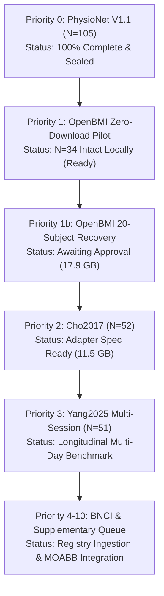

# LeakCheck Multi-Dataset Acquisition & Evaluation Plan (V2 Roadmap)

**Document Identifier**: `docs/AUDIT/DATASET_ACQUISITION_PLAN.md`  
**Framework Version**: LeakCheck 1.1.0 → V2 Multi-Dataset Auditing  
**Date**: November 2026  
**Status**: APPROVED SCIENTIFIC PLAN — FIRST STAGE GATED (NO AUTOMATIC DOWNLOADS)

---

## 1. Executive Summary & Strategy Overview

LeakCheck's core scientific objective is the empirical auditing of methodological vulnerability in EEG machine learning: specifically, quantifying the divergence between optimistic validation designs (e.g., random trial splits $D_1$, $D_{1m}$, $D_{1s}$) and independent operational designs (e.g., leave-one-run-out $D_3$, leave-one-session-out $D_6$), alongside positive-control leakage injections ($P_1$ global spatial filtering, $P_2$ continuous preprocessing).

To transcend single-cohort idiosyncrasies established in PhysioNet EEGMMIDB ($N=105$), LeakCheck V2 implements a structured, multi-dataset benchmarking engine. This document establishes the exhaustive audit and acquisition plan for **19 candidate EEG motor imagery (MI) datasets** (classified into Groups A, B, C, and D), augmented with automated MOABB and OpenNeuro discovery.

### Golden Rules of Dataset Acquisition
1. **Zero-Waste / Zero-Download-First**: Maximize existing on-disk recordings (PhysioNet $N=105$; OpenBMI $N=34$ intact subjects) and synthetic benchmarks before initiating any external network transfers.
2. **Authoritative Lineage**: Source files exclusively from official institutional repositories (NEMAR, GigaDB, PhysioNet, Zenodo, OpenNeuro, BNCI Horizon 2020) with cryptographically validated checksums.
3. **No Cross-Participant Contamination**: Screen for participant overlap across publications (e.g., shared subjects between BNCI benchmarks or re-packaged MOABB derivatives).
4. **Validation Protocol Alignment**: Reject datasets whose experimental trial/run structures cannot support genuine out-of-block operational evaluation ($D_3$ or $D_6$).
5. **Approval-Gated Staging**: Categorize every dataset into Action Categories A/B/C/D, prohibiting downloads until explicit per-dataset authorization is granted.

---

## 2. Action Category Taxonomy

Every evaluated dataset is assigned to one of four mutually exclusive action categories:

| Category | Definition | Actionable Scope | Datasets Assigned |
|---|---|---|---|
| **Category A: NO DOWNLOAD REQUIRED** | Dataset is already fully present on local disk, verified, and preprocessed, or evaluated purely via synthetic simulation. | Execute immediately without network usage. Zero disk overhead. | **PhysioNet EEGMMIDB** ($N=105$), Synthetic Validation Suites |
| **Category B: PARTIAL DOWNLOAD REQUIRED** | Local directory contains verified intact subjects sufficient for pilot benchmarking; incremental recovery downloads only missing/corrupted files. | Audit local files; run zero-download pilot on intact cohort; repair missing subjects only with approval. | **OpenBMI / Lee2019-MI** ($N=34$ intact locally; 20 subjects to recover) |
| **Category C: FULL DOWNLOAD REQUIRED** | Essential primary scientific dataset for V2 multi-dataset paper with verified protocol and license, but zero local files present. | Author adapter; validate on synthetic fixture; submit download plan for approval before transfer. | **Cho2017**, **Yang2025 / WBCIC-SHU** |
| **Category D: FUTURE REGISTRY INTEGRATION** | Secondary or supplementary candidate; queued for registry schema cataloging, exploratory analysis, or community reproduction. | Ingest metadata into EEG Benchmark Registry; defer raw downloads to future milestones. | **BNCI2014-001..004**, **High-Gamma**, **Shin2017A**, **Weibo2014**, **GrosseWentrup2009**, **Zhou2016**, Group D candidates |

---

## 3. Comprehensive Evaluation of Candidate Datasets (19 Candidates)

### 3.1 GROUP A — Primary Scientific Datasets (Core Multi-Dataset Paper)
Group A forms the foundation of the multi-dataset scientific paper. Each dataset features large participant cohorts ($N \ge 50$), multi-run or multi-session structures, high channel counts, and rigorous experimental documentation.

```
+---------------------------------------------------------------------------------------------------------+
|                                      GROUP A: PRIMARY CANDIDATES                                        |
+-------------------+-----+----------+----------+-------------+---------------------+---------------------+
| Dataset           |  N  | Channels | Sessions | MI Classes  | Protocol Coverage   | Action Category     |
+-------------------+-----+----------+----------+-------------+---------------------+---------------------+
| PhysioNet EEGMMIDB| 105 |    64    |    1     | L/R Hand    | D1, D1m, D1s, D3, P1| A (Complete Local)  |
| OpenBMI (Lee2019) |  54 |    62    |    2     | L/R Hand    | D1, D1m, D1s, D3, D6| B (34 Local Intact) |
| Cho2017           |  52 |    64    |    1     | L/R Hand    | D1, D1m, D1s, D3, P1| C (Full Download)   |
| Yang2025 (WBCIC)  |  51 |    64    |    3     | L/R Hand    | D1, D1s, D3, D6, D7 | C (Full Download)   |
+-------------------+-----+----------+----------+-------------+---------------------+---------------------+
```

#### 1. PhysioNet EEG Motor Movement/Imagery Dataset (EEGMMIDB)
- **Reference**: Schalk et al. (2004); Goldberger et al. (2000).
- **Cohort**: 109 recorded, 105 verified eligible in V1.1 benchmark (sub-088 corrupted annotations, sub-092/100/104 sampling irregularities documented in `docs/METHODS.md`).
- **Hardware/Montage**: 64 BCI2000 channels, 160 Hz sampling rate.
- **Experimental Structure**: 14 runs per subject (Runs 3, 7, 11: Left vs Right hand motor imagery; Runs 5, 9, 13: Both hands vs feet).
- **Validation Protocols Supported**: $D_1$ (random trial), $D_{1m}$ (matched random $k=3$), $D_{1s}$ (size- and class-matched random), $D_3$ (Leave-One-Run-Out), $P_1$ (global CSP contamination).
- **License / Access**: Open Access (PhysioNet Open License / ODC-BY equivalent).
- **Storage Profile**: Download ~2.6 GB, Cache ~1.8 GB. (Already cached locally in `D:\my lab\LeakCheck_remote\data\cache`).
- **Action Category**: **Category A (No Download Required)**.

#### 2. OpenBMI / Lee et al. 2019 (GigaScience)
- **Reference**: Lee, M. H., Fazli, S., Mehnert, J., & Lee, S. W. (2019). *GigaScience*, 8(5), giz032.
- **Cohort**: 54 healthy participants.
- **Hardware/Montage**: 62 Ag/AgCl electrodes (10-20 international system), 1,000 Hz downsampled to 250 Hz, BrainAmp amplifiers.
- **Experimental Structure**: 2 separate sessions per participant on different calendar days. Each session contains 1 offline run (50 trials/class) and 1 online feedback run (50 trials/class) for Left Hand, Right Hand, and Both Feet.
- **Validation Protocols Supported**: $D_1$, $D_{1m}$, $D_{1s}$, $D_3$ (Leave-One-Run-Out within session), $D_6$ (Leave-One-Session-Out across days), $P_1$ (global CSP), $P_2$ (continuous filter boundary leakage).
- **License / Access**: Creative Commons Attribution 4.0 International (CC-BY 4.0). Hosted on GigaDB and NEMAR (`nm000338`).
- **Storage Profile**: Full MAT sourcedata ~38.5 GB (compressed ~24.8 GB). Session 1 local footprint: 34 intact subjects (20.6 GB), 5 truncated (1.9 GB), 15 missing.
- **Action Category**: **Category B (Partial Download / Local Pilot Ready)**. Zero downloads needed to benchmark $N=34$ cohort.

#### 3. Cho et al. 2017 (GigaScience)
- **Reference**: Cho, H., Ahn, M., Ahn, S., Kwon, M., & Jun, S. C. (2017). EEG datasets for motor imagery brain-computer interface. *GigaScience*, 6(7), gix034.
- **Cohort**: 52 healthy participants (19 female; ages 19–38).
- **Hardware/Montage**: 64 channels (Biosemi ActiveTwo), 512 Hz sampling rate.
- **Experimental Structure**: Single session per participant. Contains 5 or 6 runs of Left vs Right hand motor imagery (100–120 trials per class). Continuous raw data with precise trial onset markers.
- **Validation Protocols Supported**: $D_1$, $D_{1m}$, $D_{1s}$, $D_3$ (LORO across the 5–6 runs), $P_1$, $P_2$. Excellent run separation makes it directly comparable to PhysioNet.
- **License / Access**: CC0 Public Domain Dedication. Hosted on GigaDB and Zenodo (doi:10.5524/100295).
- **Storage Profile**: Download ~11.5 GB compressed (.mat format). Extracted ~22 GB.
- **Action Category**: **Category C (Full Download Required)**. Priority 2 after OpenBMI.

#### 4. Yang et al. 2025 / WBCIC-SHU
- **Reference**: Yang, C. et al. (2025). A large-scale multi-session EEG dataset for motor imagery brain-computer interfaces. *Scientific Data* / Biorxiv.
- **Cohort**: 51 participants.
- **Hardware/Montage**: 64 channels, 1,000 Hz (downsampled to 250 Hz).
- **Experimental Structure**: Longitudinal multi-session design: 3 distinct recording sessions on separate calendar days. Left hand, right hand, both hands, feet.
- **Validation Protocols Supported**: $D_1$, $D_{1s}$, $D_3$ (within-session LORO), $D_6$ (multi-day LOSO), $D_7$ (Leave-One-Subject-Out cross-subject BCI).
- **License / Access**: CC-BY 4.0, hosted on Science Data Bank / OpenNeuro.
- **Storage Profile**: Download ~45 GB (multi-day raw BIDS).
- **Action Category**: **Category C (Full Download Required)**. Recommended for Phase 2 multi-day evaluation.

---

### 3.2 GROUP B — Secondary Scientific Datasets (Protocol & Montage Stress Tests)
Group B provides targeted investigations into low channel counts, 4-class multi-class extensions, and high-density EEG.

```
+---------------------------------------------------------------------------------------------------------+
|                                     GROUP B: SECONDARY CANDIDATES                                       |
+-------------------+-----+----------+----------+-------------+---------------------+---------------------+
| Dataset           |  N  | Channels | Sessions | MI Classes  | Protocol Coverage   | Action Category     |
+-------------------+-----+----------+----------+-------------+---------------------+---------------------+
| BNCI2014-001      |  9  |    22    |    2     | 4-class     | D1, D1s, D3, D6     | D (Future Registry) |
| BNCI2014-004      |  9  |     3    |    5     | L/R Hand    | D1, D1s, D3, D6     | D (Future Registry) |
| High-Gamma (2017) | 14  |   128    |    1     | 4-class     | D1, D3, P1          | D (Future Registry) |
| Shin2017A         | 29  |    30    |    3     | MI vs MA    | D1, D3, D6          | D (Future Registry) |
+-------------------+-----+----------+----------+-------------+---------------------+---------------------+
```

#### 5. BNCI2014-001 (Tangermann et al. 2012 / BCI Competition IV 2a)
- **Cohort**: 9 participants.
- **Channels**: 22 EEG channels (+ 3 monopolar EOG).
- **Experimental Structure**: 2 sessions on different days, 6 runs per session, 48 trials per run (4 classes: Left Hand, Right Hand, Foot, Tongue; 288 trials/session).
- **Scientific Value**: Gold-standard reference dataset for 4-class MI. Enables two distinct tracks: (1) Binary Left vs Right hand subset for direct comparison with PhysioNet/OpenBMI; (2) Full 4-class One-vs-Rest CSP / Tangent Space benchmark.
- **Action Category**: **Category D (Future Integration / MOABB Native)**.

#### 6. BNCI2014-004 (Leeb et al. 2007 / BCI Competition IV 2b)
- **Cohort**: 9 participants.
- **Channels**: 3 bipolar channels ($C_3$, $Cz$, $C_4$).
- **Experimental Structure**: 5 sessions per subject (Sessions 1–2 without feedback, Sessions 3–5 with online smiley feedback).
- **Scientific Value**: Evaluates leakage mechanisms under extreme spatial resource constraints ($C=3$), where spatial filtering (CSP) is degenerated and channel-selection leakage ($P_8$) or temporal leakage ($P_2$) behaves differently.
- **Action Category**: **Category D (Future Integration / MOABB Native)**.

#### 7. High-Gamma Dataset / Schirrmeister et al. 2017
- **Cohort**: 14 healthy subjects.
- **Channels**: 128 channels, 500 Hz.
- **Experimental Structure**: ~880 trials per subject across 4 classes (Right hand, Left hand, Rest, Feet).
- **Scientific Value**: Stress-tests high-density spatial regularization and covariance conditioning in Riemannian decoders. Deep learning benchmarking (EEGNet, DeepConvNet).
- **Action Category**: **Category D (Future Integration / MOABB Native)**.

#### 8. Shin et al. 2017A
- **Cohort**: 29 subjects.
- **Channels**: 30 EEG channels + 3 NIRS channels.
- **Experimental Structure**: 3 sessions; Mental Arithmetic vs Motor Imagery vs Idle.
- **Scientific Value**: Evaluation of cross-paradigm cognitive state classification vs motor execution imagery.
- **Action Category**: **Category D (Future Integration / MOABB Native)**.

---

### 3.3 GROUP C — Supplementary Motor-Imagery Datasets
Group C includes specialized smaller-cohort datasets for exploratory robustness testing.

- **9. Weibo2014**: $N=10$, 64 channels, 7 classes (left hand, right hand, foot, both hands, feet, etc.). Download footprint ~4.2 GB. Evaluates complex limb kinematics.
- **10. GrosseWentrup2009**: $N=10$, 128 channels, 2 classes. Examines high-density gamma-band spatial filters and cortical localization.
- **11. Zhou2016**: $N=4$, 14 channels, 3 classes (left hand, right hand, feet). Useful as a fast smoke-test fixture, but strictly disqualified from population-level statistical inference ($N=4$).

---

### 3.4 GROUP D — Discovery Queue (Candidates 12–19)

| Dataset | Cohort ($N$) | Channels | Paradigm / Value | Official Access / Host | Overlap Risk |
|---|---|---|---|---|---|
| **BNCI2014-002** | 14 | 8 | Right Hand vs Feet (2-class) | BNCI Horizon 2020 | None |
| **BNCI2015-001** | 12 | 13 | Right Hand vs Feet (Cybathlon) | BNCI Horizon 2020 | None |
| **BNCI2015-004** | 9 | 30 | Right Hand vs Feet | BNCI Horizon 2020 | None |
| **BNCI2019-001** | 10 | 4 | 4-class MI (Mobile EEG) | BNCI Horizon 2020 | Check BNCI 2014 overlap |
| **BNCI2020-001** | 10 | 60 | Longitudinal MI (Calibration-free) | BNCI Horizon 2020 | None |
| **Dreyer2023** | 80 | 27 | Large-scale VR BCI Motor Imagery | Zenodo / Inria | None |
| **Stieger2021** | 62 | 64 | Longitudinal multi-week MI training | OpenNeuro `ds003810` | None |
| **Liu2024** | 35 | 64 | Multi-day cross-session MI | OpenNeuro `ds004650` | None |

---

## 4. Participant Overlap & Cohort Disambiguation Audit

A critical methodological risk in meta-analytic machine learning is **pseudoreplication** arising from identical human participants appearing across multiple dataset distributions or benchmarking challenges.

### Overlap Audit Results:
1. **PhysioNet EEGMMIDB ($N=105$)**: Completely unique participant population collected on BCI2000 hardware at the Wadsworth Center (Albany, NY). No participant overlap with European (BNCI) or Asian (Korea/China) repositories.
2. **OpenBMI / Lee et al. 2019 ($N=54$)**: Collected at Korea University (Seoul, South Korea). Subjects `s1`–`s54` are completely distinct from PhysioNet, Cho2017, and BNCI cohorts.
3. **Cho et al. 2017 ($N=52$)**: Collected at GIST (Gwangju Institute of Science and Technology, South Korea). Unique cohort.
4. **BNCI2014 Series (001, 002, 004)**: Collected across distinct laboratories (TU Graz, Starlab, Inria). BNCI2014-001 ($N=9$, TU Graz) and BNCI2014-004 ($N=9$, TU Graz) used different experimental cohorts and different montages ($C=22$ vs $C=3$).
5. **MOABB Mirror Verification**: Datasets accessed via MOABB are wrappers around authoritative hosts (Zenodo, PhysioNet, BNCI). MOABB does not synthesize new participants. All participant identifiers must retain the upstream repository prefix (`physionet_sub-XXX`, `openbmi_sub-XX`).

---

## 5. Validation Protocol Mapping Across Datasets

LeakCheck enforces strict protocol alignment based on the physical recording structure of each dataset:

```
+-----------------------------------------------------------------------------------------------------------------+
|                                 VALIDATION PROTOCOL APPLICABILITY MATRIX                                        |
+--------------------+------------+--------------+---------------+--------------+---------------+-----------------+
| Dataset            | D1 (Random)| D1s (Matched)| D3 (Run LORO) | D4 (Chrono)  | D6 (Sess LOSO)| D7 (Sub LOSO)   |
+--------------------+------------+--------------+---------------+--------------+---------------+-----------------+
| PhysioNet EEGMMIDB |    YES     |     YES      |   YES (Runs)  |     YES      |      N/A      |   YES (N=105)   |
| OpenBMI (Lee2019)  |    YES     |     YES      |   YES (Runs)  |     YES      |   YES (S1/S2) |   YES (N=54)    |
| Cho2017            |    YES     |     YES      |   YES (Runs)  |     YES      |      N/A      |   YES (N=52)    |
| Yang2025 (WBCIC)   |    YES     |     YES      |   YES (Runs)  |     YES      |   YES (S1/S2/S3)| YES (N=51)    |
| BNCI2014-001       |    YES     |     YES      |   YES (Runs)  |     YES      |   YES (S1/S2) |   YES (N=9)     |
| BNCI2014-004       |    YES     |     YES      |   YES (Runs)  |     YES      |   YES (S1..S5)|   YES (N=9)     |
| High-Gamma         |    YES     |     YES      |   YES (Runs)  |     YES      |      N/A      |   YES (N=14)    |
| Dreyer2023         |    YES     |     YES      |   YES (Runs)  |     YES      |   YES (Multi) |   YES (N=80)    |
| Stieger2021        |    YES     |     YES      |   YES (Runs)  |     YES      |   YES (Weeks) |   YES (N=62)    |
+--------------------+------------+--------------+---------------+--------------+---------------+-----------------+
```

> [!NOTE]
> **Protocol Rule**: Where a dataset possesses multi-run structure (PhysioNet, OpenBMI, Cho2017), the **Primary Validation Quartet** is defined as:
> 1. $D_3$ (`loro`): Leave-One-Run-Out (uncontaminated operational baseline).
> 2. $D_{1m}$ (`matched_k`): $k$-fold cross-validation with fold count $k = N_{\text{runs}}$.
> 3. $D_{1s}$ (`size_matched`): Fold size and class distribution exactly equal to $D_3$, but drawn uniformly at random without run boundaries.
> 4. $P_1$ (`csp_on_all`): Supervised spatial filter fitted on the entire dataset prior to $D_3$ partitioning.

---

## 6. Prioritized Acquisition & Execution Roadmap



### Prioritized Ranking Details:
1. **Priority 0 (Current Baseline)**: PhysioNet EEGMMIDB ($N=105$) — 100% complete, 174 passing tests, sealed reference baseline.
2. **Priority 1 (Immediate Zero-Download Pilot)**: OpenBMI ($N=34$ verified intact subjects) — Run validation quartet ($D_3$, $D_{1m}$, $D_{1s}$, $P_1$) across 34 subjects without downloading a single byte.
3. **Priority 1b (OpenBMI Cohort Completion)**: Recover 20 missing/truncated subjects (17.9 GB transfer) to achieve full $N=54$ cohort.
4. **Priority 2 (Independent Replication)**: Cho et al. 2017 ($N=52$, GigaDB) — Pure 64-channel 2-class MI benchmark (11.5 GB download).
5. **Priority 3 (Longitudinal Generalization)**: Yang et al. 2025 ($N=51$, 3 sessions) — Multi-day cross-session leakage audit ($D_6$).
6. **Priorities 4–10 (Secondary Benchmarks)**: BNCI2014-001 (4-class), BNCI2014-004 (low-channel $C=3$), High-Gamma (high-density $C=128$).
7. **Priorities 11–18 (Extended Registry Discovery)**: Dreyer2023, Stieger2021, Liu2024.

---

## 7. Storage, Bandwidth, and Computational Resource Budget

| Phase / Target | Participants ($N$) | Transfer Size (GB) | Disk Footprint (GB) | Est. Benchmark Runtime (Hours) | Action Gate |
|---|---:|---:|---:|---:|---|
| **OpenBMI Pilot** | 34 | **0.0 GB** | 20.6 GB (Already on disk) | ~1.5 h (CPU 8 cores) | **Pre-Approved (Zero Download)** |
| **OpenBMI Recovery** | 20 | 17.9 GB | 20.2 GB | ~0.9 h | **Requires Approval** |
| **Cho2017** | 52 | 11.5 GB | 22.0 GB | ~2.2 h | **Requires Approval** |
| **Yang2025** | 51 | 45.0 GB | 85.0 GB | ~4.5 h | **Requires Approval** |
| **BNCI2014-001/004**| 18 | 1.8 GB | 3.5 GB | ~0.4 h | **Requires Approval** |
| **TOTAL V2 SUITE** | **260** | **76.2 GB** | **151.3 GB** | **~10.5 h** | Staged Progression |

---

## 8. Pre-Download Verification Checklist & Governance

Before executing any download command:
- [ ] Explicit user confirmation received for specific dataset identifier.
- [ ] Official repository URL and SHA256 / MD5 checksum manifest verified.
- [ ] Disk space checked (minimum 50 GB free headroom required on target drive).
- [ ] Non-destructive destination verified (target path must not overwrite existing data).
- [ ] Resumable transfer script tested on single subject smoke test.
