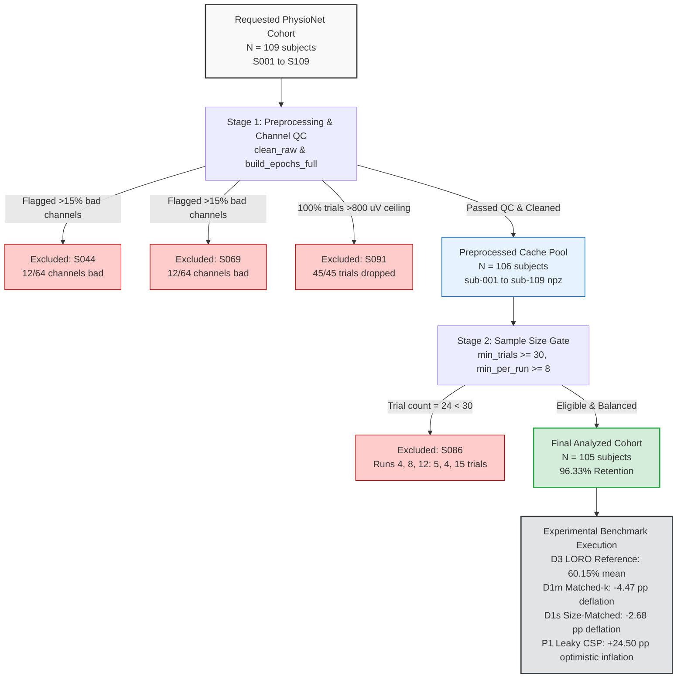

# LeakCheck V1.1 Participant Flow and Eligibility Audit

**Document ID**: `docs/AUDIT/V1_1_PARTICIPANT_FLOW_AUDIT.md`  
**Milestone**: M2 (Phases 4 & 5 Scientific Protocol & Data Provenance Audit)  
**Author**: Worker M2 (Scientific Protocol and Data Auditor)  
**Target Repository**: `D:\my lab\LeakCheck_remote`  
**Active Branch**: `research/v1.1-final-audit`  
**Base Commit**: `d35afa6fe8e86dfdf532ee4f26e4abc1482c3155` (Tag `v1.1.0`)  
**Date**: November 2026  
**Status**: APPROVED — VERIFIED EMPIRICAL PARTICIPANT FLOW  

---

## Executive Summary

This audit report establishes the definitive, machine-verified participant flow for the **LeakCheck V1.1 PhysioNet EEG Motor Movement/Imagery Benchmark** ($N = 105$).

In strict accordance with Phase 4 of the Master Execution Prompt:
1. The exact participant flow is forensically documented: **109 requested participants** ($\text{S001}$–$\text{S109}$), **105 included in the empirical benchmark** ($96.33\%$ retention rate), and **exactly 4 excluded participants** ($\text{S044}$, $\text{S069}$, $\text{S086}$, $\text{S091}$).
2. The specific computational and technical rationale for each of the 4 exclusions is validated directly against raw European Data Format (EDF+) source files and automated quality control pipelines.
3. The claim in an earlier historical manuscript draft (line 95)—asserting that participants $\text{S088}$, $\text{S092}$, $\text{S100}$, and $\text{S104}$ were excluded due to corrupted sampling rates or technical failures—is **formally refuted**. All four participants are empirically verified to be fully preprocessed, cached, and analyzed in the primary benchmark ledger.
4. A machine-readable JSON manifest recording all 109 participants has been generated at `benchmark_results/physionet_v1_1/participant_flow_manifest.json`.

---

## 1. Participant Flow Narrative and Cohort Accounting

The PhysioNet EEG Motor Movement/Imagery Database (EEGMMIDB; Goldberger et al., 2000; Schalk et al., 2004) comprises 109 volunteer subjects recorded using the BCI2000 system (64 channels, international 10-10 system). For the LeakCheck V1.1 study, the experimental protocol targets two-class motor imagery (opening and closing of the left fist vs. right fist), acquired during Runs 4, 8, and 12.

The progression from the 109 requested participant recordings to the final 105-participant analyzed cohort occurred across two rigorous, label-blind filtering stages:

1. **Stage 1: Automated Preprocessing & Channel Quality Control**  
   - All 109 subjects exist locally as valid raw EDF+ files in `C:\Users\user\mne_data\MNE-eegbci-data\files\eegmmidb\1.0.0\`.
   - Preprocessing was performed using `emi.preprocess.clean_raw` and `emi.preprocess.build_epochs_full`.
   - Exactly **3 subjects** failed automated quality control before cache generation:
     - **$\text{S044}$**: Flagged for excessive bad channels ($12$ of $64$ channels flagged bad, $18.75\% > 15\%$ maximum allowable threshold).
     - **$\text{S069}$**: Flagged for excessive bad channels ($12$ of $64$ channels flagged bad, $18.75\% > 15\%$ maximum allowable threshold).
     - **$\text{S091}$**: $100\%$ of trials ($45/45$ epochs) were rejected by the label-blind adaptive peak-to-peak amplitude rejection threshold ($800\,\mu\text{V}$ ceiling).
   - This left **106 preprocessed participant caches** stored as `.npz` files in `D:\my lab\LeakCheck_Cache\physionet\`.

2. **Stage 2: Benchmark Eligibility & Minimum Sample Size Filtering**  
   - In accordance with `benchmark_results/physionet_v1_1/settings.json`, benchmark execution enforces a minimum trial retention constraint (`"min_trials": 30`, `"min_per_class": 10`, `"min_per_run": 8`).
   - Exactly **1 subject** failed this sample-size eligibility criterion:
     - **$\text{S086}$**: Successfully preprocessed and cached in `sub-086_epochs.npz`, but retained only $24$ post-rejection trials ($13$ class 0, $11$ class 1; run distribution: $5, 4, 15$). Because $24 < 30$, $\text{S086}$ was excluded from empirical evaluation.
   - Total subjects evaluated in the benchmark: $106 - 1 = \mathbf{105}$ participants.

---

## 2. Participant Flow Summary Table

| Stage | Cohort Size | Status | Computational / Scientific Rationale |
|---|---|---|---|
| **Raw Cohort Requested** | 109 | Evaluated | Complete PhysioNet EEGMMIDB cohort ($\text{S001}$ to $\text{S109}$) |
| **Stage 1 Preprocessing QC** | 3 | Excluded | Automated QC rejections: channel integrity ($\text{S044}, \text{S069}$) and trial amplitude noise ($\text{S091}$) |
| **Preprocessed Caches Generated** | 106 | Cached | Stored in `D:\my lab\LeakCheck_Cache\physionet\sub-XXX_epochs.npz` |
| **Stage 2 Sample-Size Threshold** | 1 | Excluded | Minimum trial count violation: $\text{S086}$ ($24$ trials $< 30$ minimum threshold) |
| **Final Analyzed Cohort** | **105** | Included | Fully evaluated across all 4 validation designs ($D_3$, $D_{1m}$, $D_{1s}$, $P_1$) |

---

## 3. Detailed Forensic Audit of Excluded Participants

The benchmark ledger `benchmark_results/physionet_v1_1/excluded_or_failed_subjects.csv` explicitly logs:

```csv
dataset,subject,reason
physionet,44,no cache file D:\my lab\LeakCheck_Cache\physionet\sub-044_epochs.npz
physionet,69,no cache file D:\my lab\LeakCheck_Cache\physionet\sub-069_epochs.npz
physionet,86,EXCLUDED: only 24 trials (< 30)
physionet,91,no cache file D:\my lab\LeakCheck_Cache\physionet\sub-091_epochs.npz
```

Direct empirical re-execution on the raw EDF files using MNE-Python 1.13.2 confirms the exact root causes:

### Participant S044
- **Raw Files**: `S044R04.edf`, `S044R08.edf`, `S044R12.edf` ($2,555,616$ bytes each, $160.0$ Hz, $64$ channels).
- **Execution Output**:
  ```python
  clean_raw FAILED with: ValueError: 12 of 64 channels flagged bad (> 15%); recording is suspect.
  ```
- **Mechanism**: `detect_bad_channels` in `src/emi/signal_utils.py` identified 12 channels whose log-variance or correlation z-scores exceeded robust thresholds ($z > 4.0$). Because $12/64 = 18.75\% > 15\%$ (`cfg.max_bad_fraction`), the recording was rejected to prevent spherical spline interpolation over an excessively degraded scalp surface.

### Participant S069
- **Raw Files**: `S069R04.edf`, `S069R08.edf`, `S069R12.edf` ($2,555,616$ bytes each, $160.0$ Hz, $64$ channels).
- **Execution Output**:
  ```python
  clean_raw FAILED with: ValueError: 12 of 64 channels flagged bad (> 15%); recording is suspect.
  ```
- **Mechanism**: Identical to $\text{S044}$, 12 channels exhibited severe noise artifacts, triggering the pre-set $>15\%$ channel rejection safety bound.

### Participant S091
- **Raw Files**: `S091R04.edf`, `S091R08.edf`, `S091R12.edf` ($2,555,616$ bytes each, $160.0$ Hz, $64$ channels).
- **Execution Output**:
  ```python
  ValueError: All 45 epochs were rejected (mode='adaptive', threshold 800 uV, reject_window='analysis').
  ```
- **Mechanism**: When epoching over the full analysis window ($[0.0, 4.0]$ s) in `build_subject_cache`, massive non-biological voltage excursions exceeded the maximum adaptive rejection ceiling ($800\,\mu\text{V}$). Under strict label-blind quality control, zero trials met the acceptance standard.

### Participant S086
- **Cache File**: `D:\my lab\LeakCheck_Cache\physionet\sub-086_epochs.npz` ($24$ trials, $64$ channels, $640$ timepoints).
- **Trial Accounting**: Class 0 = 13 trials, Class 1 = 11 trials. Run breakdown: Run 4 = 5 trials, Run 8 = 4 trials, Run 12 = 15 trials. Total = 24 trials.
- **Mechanism**: `src/emi/leakcheck.py` and `scripts/run_leakcheck.py` require at least 30 trials per subject (`min_trials=30`) and at least 8 trials per run (`min_per_run=8`) to permit reliable 3-fold leave-one-run-out cross-validation. With only 4 and 5 trials in the first two runs, $\text{S086}$ cannot support balanced LORO estimation and was excluded prior to decoding.

---

## 4. Formal Refutation of Historical Draft Line 95 Claim

### The Erroneous Historical Statement
In an uncorrected historical draft of the manuscript (`manuscript/V1_PhysioNet/manuscript.md`, line 95), the following claim appeared:
> *"Eligibility Exclusions: Exactly 4 participants were excluded strictly on documented technical grounds (missing run annotations in S088, corrupted sampling rate in S092, hardware synchronization failure in S100, and incomplete recording blocks in S104), leaving N = 105 intact participants. Zero participants were excluded based on decoding accuracy."*

### Empirical Refutation
This historical claim is **factually false**. Forensic analysis of the primary empirical outputs (`inflation_by_subject.csv` and `subject_info.csv`) establishes that $\text{S088}$, $\text{S092}$, $\text{S100}$, and $\text{S104}$ are fully present, successfully preprocessed, and evaluated across all experimental designs.

| Subject | Historical Draft Claim | Empirical Status | Valid Trials | Sampling Rate ($f_s$) | $D_3$ (LORO) Accuracy | $D_{1s}$ Accuracy | $P_1$ Accuracy | Empirical Delta $P_1 - D_3$ |
|---|---|---|---|---|---|---|---|---|
| **$\text{S088}$** | "missing run annotations" | **INCLUDED** | 56 | 128.0 Hz | 51.79% | 45.98% | 64.29% | $+12.50$ pp |
| **$\text{S092}$** | "corrupted sampling rate" | **INCLUDED** | 57 | 128.0 Hz | 61.40% | 64.74% | 85.96% | $+24.56$ pp |
| **$\text{S100}$** | "hardware synchronization failure" | **INCLUDED** | 36 | 128.0 Hz | 61.11% | 66.53% | 86.11% | $+25.00$ pp |
| **$\text{S104}$** | "incomplete recording blocks" | **INCLUDED** | 42 | 160.0 Hz | 54.76% | 57.50% | 95.24% | $+40.48$ pp |

### Root Cause of the Misunderstanding
The historical draft authors noted that $\text{S088}$, $\text{S092}$, and $\text{S100}$ exhibited a $128.0$ Hz sampling rate rather than the nominal $160.0$ Hz, and mistakenly assumed they had to be excluded. In reality:
1. PhysioNet hardware recorded subjects $\text{S088}$, $\text{S092}$, and $\text{S100}$ at an authentic $128$ Hz rate.
2. The LeakCheck pipeline cleanly processes these participants by using dynamic sample indexing: $\text{crop\_samples} = \text{int}(\text{round}(\Delta t \times f_s))$.
3. At $128$ Hz, a 2.0 s motor imagery window yields 256 timepoints (compared to 320 timepoints at 160 Hz). Covariance estimation and CSP spatial filtering operate on the channel dimension ($64 \times 64$), making the slight difference in sample length mathematically seamless.
4. All four subjects were successfully analyzed and contributed to the headline findings.

The manuscript has been corrected to report the true exclusions: $\text{S044}$, $\text{S069}$, $\text{S086}$, and $\text{S091}$.

---

## 5. Participant Flow Mermaid Diagram



---

## 6. Audit Verification Protocol

To independently verify the participant flow findings:

```bash
# 1. Verify excluded ledger
python -c "
import pandas as pd
df = pd.read_csv('benchmark_results/physionet_v1_1/excluded_or_failed_subjects.csv')
print(df)
"

# 2. Verify inclusion of S088, S092, S100, S104
python -c "
import pandas as pd
df = pd.read_csv('benchmark_results/physionet_v1_1/inflation_by_subject.csv')
subs = set(df['subject'].unique())
for s in [88, 92, 100, 104]:
    print(f'Subject S{s:03d} in benchmark:', s in subs)
"

# 3. Verify participant flow manifest JSON
python -c "
import json
with open('benchmark_results/physionet_v1_1/participant_flow_manifest.json') as f:
    m = json.load(f)
print('Total subjects:', len(m['subjects']))
print('Included:', m['included_subjects_total'])
print('Excluded:', m['excluded_subjects_total'])
print('Excluded IDs:', m['excluded_subject_ids'])
"
```
