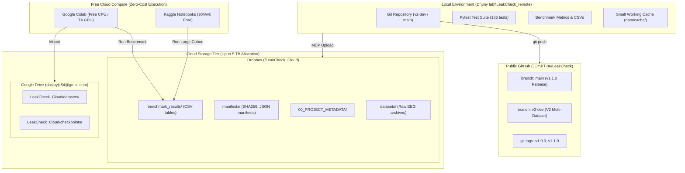

# Cloud Execution & Storage Architecture (LeakCheck V2)

> [!IMPORTANT]
> **Zero-Cost Constraint Notice**  
> All cloud architectures described herein adhere to a strict **\$0.00 spend boundary**. No paid compute, no pay-per-gigabyte egress, and no billable cloud trials are permitted. Execution relies entirely on free compute tiers (Google Colab, Kaggle Notebooks) and authenticated personal cloud storage allocations (Dropbox, Google Drive).

---

## 1. Storage Architecture Overview

EEG datasets across multi-subject motor imagery cohorts can exceed tens or hundreds of gigabytes (e.g., OpenBMI raw continuous data $\approx 45$ GB; Cho et al. 2017 $\approx 15$ GB; PhysioNet EEGMMIDB cache $\approx 8$ GB). A dual-tier storage strategy decouples high-bandwidth binary data from version-controlled scientific code:



---

## 2. Authenticated Cloud Storage Integrations

### 2.1 Dropbox Integration (`/LeakCheck_Cloud`)
- **Primary Account**: `dasjoyjit84@gmail.com`
- **Tool Protocol**: Antigravity Dropbox MCP Server (`dropbox_dropbox`)
- **Base Root**: `/LeakCheck_Cloud`
- **Directory Hierarchy**:
  ```text
  /LeakCheck_Cloud/
  ├── 00_PROJECT_METADATA/              # Provenance, license, contact info
  ├── manifests/                         # Cryptographic checksums & execution manifests
  │   ├── SHA256SUMS.txt                # Release wheel and sdist sha256 sums
  │   ├── physionet_v1_1_summary.json   # PhysioNet N=105 benchmark execution parameters
  │   └── openbmi_v2_manifest.json      # OpenBMI N=34 benchmark execution parameters
  ├── benchmark_results/                 # Primary comparative metric tables
  │   ├── physionet_v1_1_inflation_table.csv
  │   └── openbmi_v2_design_comparisons.csv
  └── datasets/                          # Remote mirrors for large EEG binaries
      ├── physionet/
      └── openbmi/
  ```

### 2.2 Google Drive Integration
- **Primary Account**: `dasjoyjit84@gmail.com`
- **Tool Protocol**: Google Drive Plugin (`gdrive`) / Direct Colab Mount
- **Base Folder**: `My Drive/LeakCheck_Cloud`
- **Colab Mounting Syntax**:
  ```python
  from google.colab import drive
  drive.mount('/content/drive')
  DATA_DIR = '/content/drive/MyDrive/LeakCheck_Cloud/datasets'
  ```

---

## 3. Free Cloud Execution Workflow (Google Colab & Kaggle)

When executing compute-intensive benchmarks on cohorts exceeding local machine capacity (such as high-sampling-rate datasets or extensive bootstrap iterations):

### 3.1 Google Colab Execution Recipe
1. Open a new Google Colab session (Standard CPU or T4 GPU).
2. Clone the development branch:
   ```bash
   !git clone -b v2-dev https://github.com/JOYJIT-06/LeakCheck.git
   %cd LeakCheck
   !pip install -e .
   ```
3. Mount Google Drive or download target dataset slice via MOABB:
   ```python
   import mne
   from emi.datasets_adapters import OpenBMIDatasetAdapter
   # Run benchmark script with sealed output
   !python scripts/run_openbmi_benchmark.py --data-dir /content/data --subjects 1-10 --outdir /content/results
   ```
4. Export results back to Google Drive or sync to Dropbox via API.

### 3.2 Kaggle Notebooks Execution Recipe
- Kaggle provides **30 hours per week** of free GPU/CPU compute with 20 GB RAM and 73 GB disk space.
- Public datasets can be mounted directly into `/kaggle/input/` without local bandwidth consumption.

---

## 4. Bandwidth and Storage Integrity Protocol

1. **No Large Binaries in Git**: All `.edf`, `.gdf`, `.mat`, `.fif`, and raw EEG files are strictly `.gitignore`d.
2. **Cryptographic Checksums**: Any artifact transferred to or from cloud storage must be accompanied by a SHA-256 manifest:
   ```bash
   certutil -hashfile dataset_archive.zip SHA256
   # or in Python:
   python -c "import hashlib; print(hashlib.sha256(open('dataset.zip','rb').read()).hexdigest())"
   ```
3. **Reproducibility Guarantee**: Every benchmark execution logs software package versions (`emi`, `mne`, `numpy`, `scipy`, `sklearn`), random seeds, operating system, and hardware architecture in `benchmark_manifest.json`.
