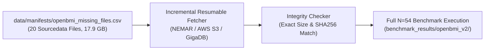

# OpenBMI Benchmark Execution Plan (V2 First Scientific Target)

**Document Identifier**: `docs/V2/OPENBMI_EXECUTION_PLAN.md`  
**Dataset Reference**: Lee et al. (2019) *GigaScience* / NEMAR `nm000338`  
**Date**: November 2026  
**Status**: APPROVED EXECUTION PLAN — STAGE 1 READY FOR ZERO-DOWNLOAD EXECUTION

---

## 1. Context & Physical Data Baseline

OpenBMI (Lee et al. 2019) is LeakCheck V2's primary multi-dataset benchmarking target. It features 54 healthy human subjects performing motor imagery (Left Hand, Right Hand, Both Feet) recorded via 62 scalp electrodes across two independent calendar days.

### 1.1 Local Audit Summary (From `docs/AUDIT/OPENBMI_DOWNLOAD_AUDIT.md`)
- **Authoritative Inventory**: 1,955 files recorded in NEMAR `nm000338` manifest.
- **Session 1 Sourcedata Status**:
  - **34 Verified Intact Subjects**: `s2`, `s3`, `s5`–`s10`, `s12`–`s39`, `s42`–`s44` (20.6 GB total on disk, exact byte match to manifest, 100% readable via `emi.datasets_openbmi`).
  - **5 Truncated Historical Files**: `s1` (3.6%), `s4` (53.4%), `s11` (73.3%), `s40` (28.6%), `s45` (76.2%).
  - **1 Empty Directory**: `s41` (0 bytes).
  - **9 Unstarted Directories**: `s46`–`s54`.
  - **Session 2 & Derivatives**: 0% local presence.

```
+---------------------------------------------------------------------------------------------------------+
|                                     OPENBMI RECOVERY & EXECUTION PHASES                                 |
+-------+--------------------------+------+----------+---------------+----------------+------------------+
| Phase | Scope                    | N    | Sessions | Transfer (GB) | Est. CPU Time  | Action Gate      |
+-------+--------------------------+------+----------+---------------+----------------+------------------+
| **1** | **Zero-Download Pilot**  | **34**| **Sess 1**| **0.0 GB**    | **~1.5 Hours** | **Awaiting Start**|
| **2** | **Session 1 Full Cohort**| 54   | Sess 1   | 17.9 GB       | ~2.4 Hours     | Requires Approval|
| **3** | **Multi-Day Cross-Sess** | 54   | S1 + S2  | 38.5 GB       | ~5.0 Hours     | Requires Approval|
+-------+--------------------------+------+----------+---------------+----------------+------------------+
```

---

## 2. Phase 1: Zero-Download Pilot Benchmark ($N=34$)

### 2.1 Scientific Objectives
1. Provide the first independent replication of LeakCheck's PhysioNet findings ($N=105$) without downloading a single byte over the network.
2. Evaluate whether size-matched random splits ($D_{1s}$) and matched random splits ($D_{1m}$) exhibit systematic negative bias relative to operational run-based validation ($D_3$) on 62-channel BrainAmp hardware.
3. Quantify the vulnerability of OpenBMI to supervised spatial filtering contamination ($P_1$, global CSP).
4. Benchmark both classical Shrinkage CSP-LDA and Riemannian Tangent Space Logistic Regression (`ts_lr`).

### 2.2 Paradigm & Trial Structure
- **Task Condition**: Binary Motor Imagery — Left Hand (`label 1`) vs. Right Hand (`label 2`).
- **Trial Counts**:
  - Run 1 (Offline Calibration): 50 Left Hand + 50 Right Hand trials = 100 trials.
  - Run 2 (Online Feedback): 50 Left Hand + 50 Right Hand trials = 100 trials.
  - Total per Subject: 200 trials.
- **Electrode Montage**: 62 EEG channels, downsampled to 250 Hz, bandpass filtered $8–30\text{ Hz}$ zero-phase FIR, epoch window $[-0.5, 4.0]\text{ s}$ relative to cue.

### 2.3 Validation Protocol Quartet
For each of the 34 intact participants, four validation protocols are evaluated deterministically:

1. **$D_3$ (`loro` — Operational Reference)**:
   - 2-fold cross-validation partitioned strictly by operational recording runs:
     - Fold 1: Train Run 1 (Offline, 100 trials) $\rightarrow$ Test Run 2 (Online, 100 trials).
     - Fold 2: Train Run 2 (Online, 100 trials) $\rightarrow$ Test Run 1 (Offline, 100 trials).
   - Simulates zero-leakage run-to-run deployment.
2. **$D_{1m}$ (`matched_k` — Matched Random Splits)**:
   - Standard stratified $k$-fold cross-validation ($k=2$).
   - Trials drawn uniformly at random from pooled runs, preserving 50% train / 50% test split.
3. **$D_{1s}$ (`size_matched` — Size- and Class-Matched Random Splits)**:
   - For each fold in $D_3$, draws exactly 50 Left Hand and 50 Right Hand trials at random without replacement from the pooled 200 trials.
   - Perfectly isolates the impact of destroying temporal run boundaries while holding sample size and class proportions constant.
4. **$P_1$ (`csp_on_all` — Supervised Spatial Contamination)**:
   - Fits CSP filters on all 200 trials simultaneously prior to executing $D_3$ partitioning.
   - Injects label-dependent spatial covariance leakage into the test set.

### 2.4 Statistical Contrast & Deliverables
- **Participant-Level Primary Contrasts**:
  $$\Delta_{\text{size-matched}, i} = \text{Acc}_{i}(D_{1s}) - \text{Acc}_{i}(D_3)$$
  $$\Delta_{\text{matched-k}, i} = \text{Acc}_{i}(D_{1m}) - \text{Acc}_{i}(D_3)$$
  $$\Delta_{\text{inflation}, i} = \text{Acc}_{i}(P_1) - \text{Acc}_{i}(D_3)$$
- **Output Artifacts**:
  - `benchmark_results/openbmi_v2/openbmi_pilot_34_results.csv`
  - `benchmark_results/openbmi_v2/openbmi_pilot_34_summary.csv`
  - `benchmark_results/openbmi_v2/figures/openbmi_paired_size_matched.png`
  - `benchmark_results/openbmi_v2/figures/openbmi_inflation_p1.png`

---

## 3. Phase 2: Session 1 Cohort Recovery ($N=54$)

To expand the pilot into a publication-grade full-cohort benchmark, the 20 missing or truncated Session 1 files will be recovered:



### 3.1 Recovery Action Items (Post-Approval)
1. Verify target directory free storage ($\ge 35\text{ GB}$ available).
2. Execute automated recovery script targeting only the 20 missing subjects listed in `data/manifests/openbmi_missing_files.csv`.
3. Validate downloaded `.mat` headers and array shapes using `emi.datasets_openbmi`.
4. Re-run validation quartet on all 54 subjects to confirm full population statistical estimates.

---

## 4. Phase 3: Cross-Session & Multi-Day Generalization ($D_6$)

Upon acquisition of Session 2 files (54 subjects, ~38.5 GB), LeakCheck V2 will execute its first **Leave-One-Session-Out ($D_6$) multi-day leakage audit**:

- **Hypothesis**: Conventional within-session validation ($D_1$, $D_3$) severely underestimates the performance degradation caused by day-to-day non-stationarity (electrode re-application, impedance shifts, cognitive fatigue).
- **Protocol**:
  - Model trained on Session 1 (200 trials) $\rightarrow$ tested on Session 2 (200 trials).
  - Model trained on Session 2 (200 trials) $\rightarrow$ tested on Session 1 (200 trials).
- **Comparison**: Contrast $D_6$ accuracy against within-session $D_3$ to quantify the **Day-to-Day Degradation Penalty** across both CSP-LDA and Riemannian decoders.

---

## 5. Execution Prerequisites & Stop Condition

> [!IMPORTANT]
> **Strict Governance Notice**:
> In compliance with the Master Prompt, **Phase 1 execution will not commence until explicit user approval is granted**.
> No external network connections or file downloads will be initiated for Phase 2 or Phase 3 without separate, dedicated approval.
