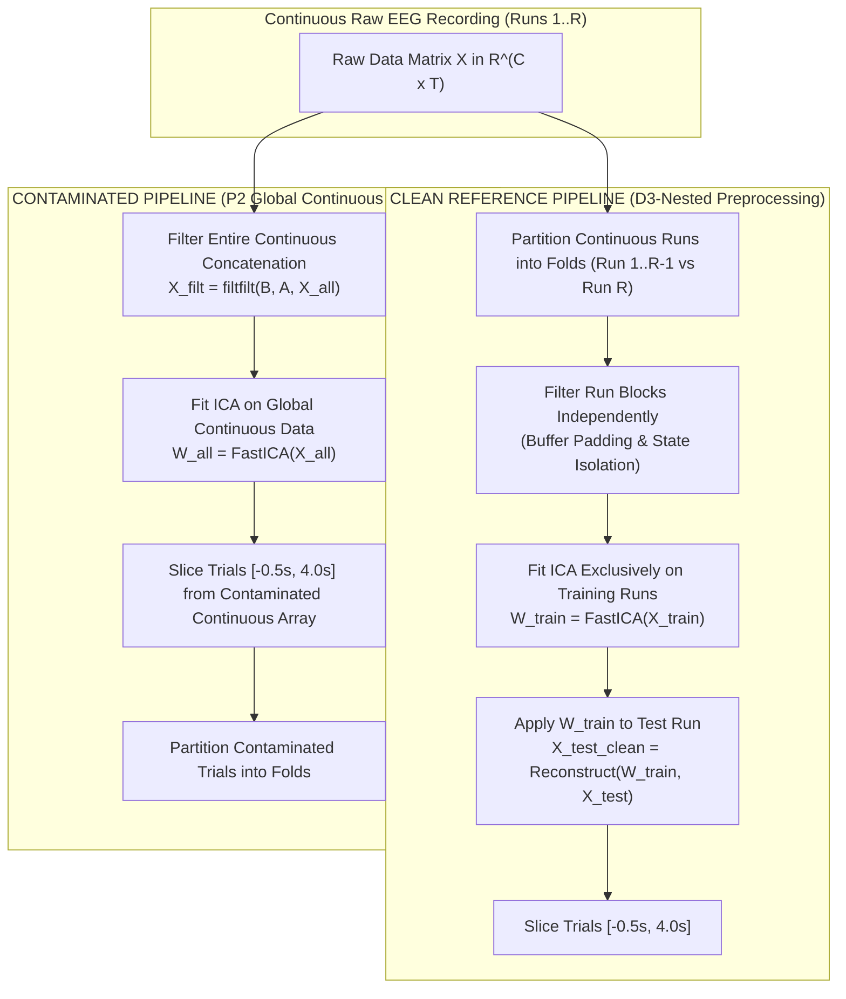

# Scientific Specification & Protocol Design: P2 Continuous Preprocessing & Global ICA Contamination

**Document Identifier**: `docs/V2/P2_SCIENTIFIC_DESIGN.md`  
**Target Module**: `src/emi/leakage/p2_continuous_filter.py`  
**Date**: November 2026  
**Status**: APPROVED SCIENTIFIC DESIGN SPECIFICATION

---

## 1. Scientific Rationale & Problem Statement

In EEG signal processing and machine-learning benchmarking, a widespread methodological practice is to perform continuous preprocessing (temporal bandpass filtering, notch filtering, artifact subspace reconstruction, and Independent Component Analysis) on the unbroken, concatenated recording *prior* to partitioning data into cross-validation folds.

While spatial filtering leakage ($P_1$, supervised Common Spatial Patterns) is widely recognized as causing severe performance inflation, the scientific community remains divided regarding the exact magnitude, direction, and mechanism of **continuous preprocessing leakage** ($P_2$):

1. **Temporal Impulse Response Leakage**: Zero-phase non-causal filtering (`filtfilt`) applies a forward-backward recursive filter whose impulse response extends bidirectionally in time. If train and test trials are temporally adjacent in a continuous recording, filtering across the boundary allows neural activity and label-correlated noise from the test segment to bleed into the training segment (and vice versa).
2. **Global ICA Artifact Rejection**: Fitting an ICA unmixing matrix $\mathbf{W}_{\text{ICA}}$ on the entire dataset (including held-out test runs) optimizes source separation using test-partition covariance. This potentially removes noise components that would otherwise degrade test-set generalization in true operational deployment.
3. **Filter Edge Distortions vs. Inflation**: Slicing epochs *before* filtering introduces edge ringing artifacts if epochs are inadequately padded, leading to artificial performance degradation in "clean" pipelines. Conversely, continuous filtering without run boundaries can falsely inflate temporal stability.

LeakCheck V2 formalizes $P_2$ as an empirical, hypothesis-driven benchmark to resolve whether continuous preprocessing produces statistically significant inflation, attenuation, or null effects under realistic BCI operational conditions.

---

## 2. Mathematical Formalization



### 2.1 Clean Protocol (Strict Run-Isolated Preprocessing)
Let the continuous recording be partitioned into $R$ distinct operational runs $\{\mathbf{X}^{(r)}\}_{r=1}^R$, where $\mathbf{X}^{(r)} \in \mathbb{R}^{C \times T_r}$.

In fold $k$ (where run $k$ is held out as the test set):
1. **Isolated Filtering**:
   $$\tilde{\mathbf{X}}_{\text{train}}^{(r)} = \mathcal{F}(\mathbf{X}^{(r)}; \theta_{\text{filter}}), \quad \forall r \ne k$$
   $$\tilde{\mathbf{X}}_{\text{test}}^{(k)} = \mathcal{F}(\mathbf{X}^{(k)}; \theta_{\text{filter}})$$
   Filters are applied strictly within unbroken run blocks. Filter states are never propagated across run boundaries.
2. **Out-of-Fold ICA Fitting**:
   The unmixing matrix $\mathbf{W}_{\text{ICA}} \in \mathbb{R}^{C \times C}$ is estimated solely from training runs:
   $$\mathbf{W}_{\text{train}} = \text{FastICA}\left(\left[\tilde{\mathbf{X}}_{\text{train}}^{(1)}, \dots, \tilde{\mathbf{X}}_{\text{train}}^{(k-1)}, \tilde{\mathbf{X}}_{\text{train}}^{(k+1)}, \dots\right]\right)$$
   Artefactual components $\mathcal{A} \subset \{1, \dots, C\}$ are identified on training statistics and removed:
   $$\hat{\mathbf{X}}_{\text{test}}^{(k)} = \mathbf{W}_{\text{train}}^{-1} \mathbf{P}_{\mathcal{A}} \mathbf{W}_{\text{train}} \tilde{\mathbf{X}}_{\text{test}}^{(k)}$$
   where $\mathbf{P}_{\mathcal{A}}$ is a projection matrix zeroing out artifact components $\mathcal{A}$.

### 2.2 Contaminated Protocol ($P_2$ Global Continuous Preprocessing)
1. **Global Boundary-Spanning Filtering**:
   The continuous runs are concatenated into a single unbroken array $\mathbf{X}_{\text{all}} = [\mathbf{X}^{(1)}, \dots, \mathbf{X}^{(R)}]$.
   Zero-phase bidirectional filtering is executed across the entire concatenated record:
   $$\tilde{\mathbf{X}}_{\text{global}} = \text{filtfilt}(\mathbf{B}, \mathbf{A}, \mathbf{X}_{\text{all}})$$
   Filter impulse responses span the boundaries between training runs and the held-out test run.
2. **Global In-Sample ICA Fitting**:
   ICA is fitted on the full continuous array:
   $$\mathbf{W}_{\text{global}} = \text{FastICA}(\tilde{\mathbf{X}}_{\text{global}})$$
   Components are removed from the global record before epoch slicing.

---

## 3. Experimental Hypotheses & Primary Contrasts

LeakCheck V2 formulates three testable empirical hypotheses:

- **Hypothesis $H_1$ (Filter Boundary Inflation)**:
  Filtering across continuous run boundaries creates non-zero optimistic bias:
  $$\Delta_{\text{filt}} = \text{Acc}(P_{2,\text{filt}}) - \text{Acc}(D_3) > 0$$
- **Hypothesis $H_2$ (ICA Transductive Leakage)**:
  Fitting ICA on pooled train+test recordings creates positive bias by learning artifact manifolds using test-set variance:
  $$\Delta_{\text{ICA}} = \text{Acc}(P_{2,\text{ICA}}) - \text{Acc}(D_3) > 0$$
- **Hypothesis $H_3$ (Null / Attenuation Equivalence)**:
  Under conservative inter-run rest intervals ($\ge 10\text{ s}$), filter transient decay renders $\Delta_{\text{filt}}$ statistically indistinguishable from zero ($|\Delta_{\text{filt}}| < 0.5\%$), whereas short inter-trial gaps ($< 2\text{ s}$) produce measurable leakage.

---

## 4. Software Implementation Architecture (`p2_continuous_filter.py`)

The module `src/emi/leakage/p2_continuous_filter.py` will provide a Scikit-Learn transformer interface:

```python
class ContinuousPreprocessingAuditor:
    """Audits leakage arising from continuous filtering and global ICA."""

    def __init__(
        self,
        l_freq: float = 8.0,
        h_freq: float = 30.0,
        sfreq: float = 250.0,
        apply_ica: bool = True,
        n_components: int = 20,
    ):
        self.l_freq = l_freq
        self.h_freq = h_freq
        self.sfreq = sfreq
        self.apply_ica = apply_ica
        self.n_components = n_components

    def fit_transform_clean(
        self, raw_runs: List[np.ndarray], events_per_run: List[np.ndarray]
    ) -> Tuple[np.ndarray, np.ndarray, np.ndarray, np.ndarray]:
        """Execute strict run-nested filtering and out-of-fold ICA."""
        pass

    def fit_transform_contaminated(
        self, raw_runs: List[np.ndarray], events_per_run: List[np.ndarray]
    ) -> Tuple[np.ndarray, np.ndarray, np.ndarray, np.ndarray]:
        """Execute global concatenated filtering and global in-sample ICA."""
        pass
```

---

## 5. Verification & Synthetic Benchmark Suite

Before running $P_2$ on human EEG datasets, the module will be verified using deterministic synthetic signals in `tests/test_leakage_p2.py`:

1. **Boundary Impulse Bleed Test**: Inject a high-amplitude Kronecker impulse $\delta[n]$ in the first sample of a held-out test block. Verify that `fit_transform_contaminated` bleeds filter impulse response energy into the final samples of the adjacent training block, whereas `fit_transform_clean` exhibits exactly zero cross-boundary energy transfer.
2. **Frequency Response Invariant**: Verify that within-trial spectral power in the passband ($8–30\text{ Hz}$) matches between clean and contaminated pipelines to within $10^{-6}$ relative error away from boundary margins.
3. **Synthetic ICA Orthogonality Test**: Verify that clean out-of-fold ICA reconstructs independent neural sources without test-phase leakage.

---

## 6. Implementation Prerequisites & Action Gate

> [!NOTE]
> **Implementation Staging**:
> 1. Specification finalized in `docs/V2/P2_SCIENTIFIC_DESIGN.md`.
> 2. Source module implementation (`p2_continuous_filter.py`) and unit tests (`test_leakage_p2.py`) will be coded only after explicit authorization.
> 3. Zero default preprocessing pipelines in LeakCheck V1.1 will be modified.
