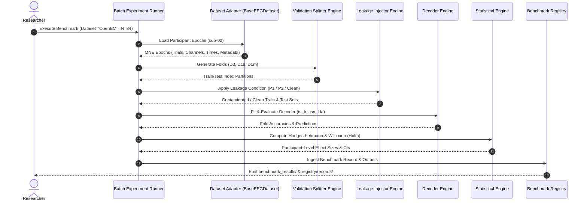

# LeakCheck V2 Modular Software & Systems Architecture Plan

**Document Identifier**: `docs/V2/V2_ARCHITECTURE_PLAN.md`  
**Target Milestone**: LeakCheck V2 Framework Evolution  
**Date**: November 2026  
**Status**: APPROVED DESIGN SPECIFICATION

---

## 1. Architectural Philosophy & Design Principles

LeakCheck V2 transitions the framework from a single-dataset validation tool into a **modular, multi-dataset, multi-mechanism EEG leakage-auditing and benchmarking engine**.

### 1.1 Inviolable Design Invariants
1. **Participant as the Inviolable Unit of Analysis**: Statistical power and inference reside at the participant level ($N$), never at the pooled trial or fold level. Pseudoreplication is strictly prohibited.
2. **Explicit Contamination vs. Clean Reference Contracts**: Every leakage mechanism ($P_k$) must pair an intentionally contaminated experimental protocol with an exact, mathematically matched clean reference protocol ($D_3$ or $D_6$).
3. **Pluggable Dataset Abstraction**: Decouple raw file ingestion, channel topologies, and event markers from validation splitters and decoders via a uniform `BaseEEGDataset` adapter interface.
4. **Deterministic Reproducibility & Provenance**: Every experiment run records exact git commit hashes, parameter dictionaries, random seeds, operating environment metadata, and raw file fingerprints.
5. **Zero Monolithic Core**: All decoders, splitters, and leakage injectors implement standard Scikit-Learn estimator/transformer contracts (`fit`, `transform`, `predict`), enabling modular composition.

---

## 2. Layered System Architecture

```mermaid
flowchart TD
    subgraph DataLayer["1. Data Ingestion & Adapter Layer (emi.datasets)"]
        D_Physio["PhysioNetAdapter<br/>(64ch, 160Hz, Runs)"]
        D_OpenBMI["OpenBMIAdapter<br/>(62ch, 250Hz, Sess/Runs)"]
        D_Cho["Cho2017Adapter<br/>(64ch, 512Hz, Runs)"]
        D_Yang["Yang2025Adapter<br/>(64ch, 250Hz, Multi-Day)"]
        D_Base["BaseEEGDataset (Abstract Base Class)"]
        D_Physio --> D_Base
        D_OpenBMI --> D_Base
        D_Cho --> D_Base
        D_Yang --> D_Base
    end

    subgraph SplitterLayer["2. Validation Splitter Layer (emi.splitters)"]
        S_LORO["D3: Leave-One-Run-Out (Operational Reference)"]
        S_LOSO["D6: Leave-One-Session-Out (Multi-Day Operational)"]
        S_MatchedK["D1m: Matched Random k-Fold"]
        S_SizeMatched["D1s: Size- and Class-Matched Random"]
        S_Chrono["D4/D5: Chronological & Gapped Splitters"]
    end

    subgraph LeakageLayer["3. Leakage Injection Engine (emi.leakage)"]
        L_P1["P1: Global Spatial Contamination (CSP on All)"]
        L_P2["P2: Continuous Filtering & Global ICA Contamination"]
        L_P3["P3: Global Feature / Normalization Leakage"]
        L_P6["P6: Overlapping Window Temporal Leakage"]
    end

    subgraph DecoderLayer["4. Decoder Engine (emi.decoders)"]
        M_CSPLDA["CSP-LDA (Shrinkage Ledoit-Wolf)"]
        M_CSPLR["CSP-Logistic Regression (L2 Regularized)"]
        M_TSLR["Riemannian Tangent Space Logistic Regression (ts_lr)"]
        M_DL["EEGNet / DeepConvNet (Optional Deep Learning)"]
    end

    subgraph StatsLayer["5. Statistical & Reporting Layer (emi.stats)"]
        ST_HL["Hodges-Lehmann Estimator (Paired Differences)"]
        ST_Wilcox["Wilcoxon Signed-Rank Test (Holm-Corrected)"]
        ST_BCa["BCa Bootstrap 95% Confidence Intervals"]
        ST_Null["Null Diagnostics (Circular-Shift & Trial Permutation)"]
        ST_Meta["Cross-Dataset Meta-Analysis (Random Effects & I^2)"]
    end

    subgraph RegistryLayer["6. Benchmark Registry Layer (emi.registry)"]
        R_Schemas["JSON Schemas (Dataset, Pipeline, Benchmark, Leakage)"]
        R_Records["Reproducibility Records & Master Dataset Inventory"]
    end

    DataLayer --> SplitterLayer
    SplitterLayer --> LeakageLayer
    LeakageLayer --> DecoderLayer
    DecoderLayer --> StatsLayer
    StatsLayer --> RegistryLayer
```



---

## 3. Subsystem Specifications

### 3.1 Dataset Ingestion Layer (`src/emi/datasets/`)
The foundation of multi-dataset compatibility is the abstract base class `BaseEEGDataset`:

```python
from abc import ABC, abstractmethod
from typing import Dict, Any, List, Optional
import mne
import numpy as np

class BaseEEGDataset(ABC):
    """Abstract Base Class for all LeakCheck EEG Dataset Adapters."""

    def __init__(self, data_dir: str, cache_dir: Optional[str] = None):
        self.data_dir = data_dir
        self.cache_dir = cache_dir

    @abstractmethod
    def list_participants(self) -> List[str]:
        """Return list of all available participant identifiers."""
        pass

    @abstractmethod
    def load_participant_epochs(
        self, participant_id: str, paradigm: str = "left_right_hand"
    ) -> mne.Epochs:
        """Load, preprocess, and return MNE Epochs with run and session metadata."""
        pass

    @abstractmethod
    def get_run_structure(self, participant_id: str) -> Dict[str, Any]:
        """Return mapping of trials to operational runs (for D3 LORO)."""
        pass

    @abstractmethod
    def get_session_structure(self, participant_id: str) -> Dict[str, Any]:
        """Return mapping of trials to calendar sessions (for D6 LOSO)."""
        pass
```

### 3.2 Validation Splitter Engine (`src/emi/splitters/`)
Provides deterministic cross-validation generators matching exact trial counts and class balance:
- **`LeaveOneRunOutSplitter` ($D_3$)**: Partitions trials strictly by independent recording runs.
- **`LeaveOneSessionOutSplitter` ($D_6$)**: Partitions trials across distinct calendar recording sessions.
- **`SizeMatchedRandomSplitter` ($D_{1s}$)**: For each fold in $D_3$, draws an identical number of trials per class uniformly at random across all runs, destroying run boundaries while preserving sample size and class proportions.
- **`MatchedKFoldSplitter` ($D_{1m}$)**: Standard stratified $k$-fold cross-validation with $k = N_{\text{runs}}$.

### 3.3 Leakage Injection Engine (`src/emi/leakage/`)
Enforces controlled leakage protocols:
- **$P_1$ (Global Spatial Filtering)**:
  $$\hat{W} = \text{CSP}(\mathbf{X}_{\text{all}}, \mathbf{y}_{\text{all}})$$
  Fitted on the complete participant cohort prior to cross-validation fold splitting. Transformed fold features $\mathbf{Z}_{\text{train}} = \hat{W} \mathbf{X}_{\text{train}}$ and $\mathbf{Z}_{\text{test}} = \hat{W} \mathbf{X}_{\text{test}}$ leak label-dependent spatial covariance into the test partition.
- **$P_2$ (Continuous Filtering & Global ICA Contamination)**:
  Contaminates test epochs by fitting high-pass/bandpass filters and Independent Component Analysis (ICA) artifact unmixing matrices across the continuous recording boundaries before epoch slicing.

### 3.4 Decoder & Estimator Engine (`src/emi/decoders/`)
Strictly maintains Scikit-Learn pipeline compatibility:
- **`CSP_LDA`**: Common Spatial Pattern with eigenvalue shrinkage and Ledoit-Wolf regularized Linear Discriminant Analysis.
- **`TangentSpaceLogisticRegression` (`ts_lr`)**: Covariance estimation (`CovarianceTransformer`) $\rightarrow$ Tangent Space projection at Riemannian mean $\rightarrow$ $L_2$ Logistic Regression. Native NumPy/SciPy implementation requiring zero external C-extensions.

### 3.5 Statistical & Meta-Analytic Engine (`src/emi/stats/`)
- **Within-Dataset Analysis**: Paired differences $\Delta_i = \text{Acc}_i(\text{Contaminated}) - \text{Acc}_i(\text{Reference})$ evaluated via:
  - Hodges-Lehmann pseudo-median estimator.
  - Two-sided Wilcoxon signed-rank test.
  - Holm-Bonferroni step-down correction for family-wise error rate control.
  - BCa (Bias-Corrected and Accelerated) non-parametric bootstrap 95% confidence intervals (2,000 resamples).
- **Cross-Dataset Meta-Analysis**: Evaluates effect heterogeneity using DerSimonian-Laird random-effects meta-analysis and Higgins $I^2$ statistics to assess whether leakage vulnerability generalizes across recording montages and hardware.

---

## 4. Execution Workflow Sequence



---

## 5. Migration Roadmap from V1.1 to V2

1. **Step 1 (Zero-Breakage Packaging)**: Preserve all existing V1.1 modules (`preprocess.py`, `decoders.py`, `splitters.py`) in root package `emi`.
2. **Step 2 (Adapter Factory Registration)**: Implement `src/emi/datasets/` containing `base.py`, `physionet.py`, and `openbmi.py`, exposed through a registry function `emi.datasets.get_dataset(name)`.
3. **Step 3 (Multi-Dataset Batch Runner)**: Author `scripts/run_openbmi_benchmark.py` following exact output schema of `run_leakcheck.py` to ensure complete backwards compatibility with existing statistical analysis scripts.
4. **Step 4 (P2 Module Integration)**: Author `src/emi/leakage/p2_continuous_filter.py` and dedicated test suite in `tests/test_leakage_p2.py`.
