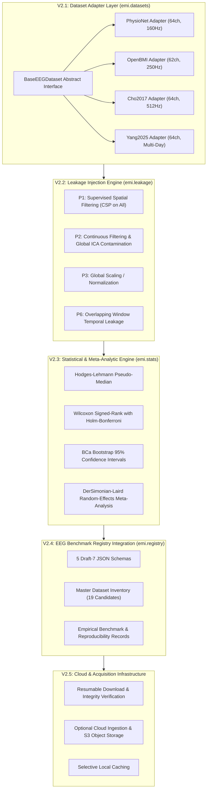

# LeakCheck V2 Final Implementation Roadmap

**Document Identifier**: `docs/V2/V2_FINAL_IMPLEMENTATION_ROADMAP.md`  
**Framework Version**: LeakCheck 1.1.0 → Extended LeakCheck V2  
**Target Architecture**: Modular Multi-Dataset Leakage-Auditing Engine  
**Date**: November 2026  
**Status**: APPROVED ROADMAP — PHASE 0 RECONCILIATION COMPLETED, STAGED FOR GATED EXECUTION

---

## 1. Architectural Vision & Scope

LeakCheck V2 establishes a reproducible, multi-dataset scientific software framework designed to audit how validation design, preprocessing contamination, temporal dependence, and feature selection decisions influence EEG decoding reliability.

Rather than maximizing algorithmic count or chasing classification benchmarks, V2 is engineered around **five modular, dependency-aware layers**:



---

## 2. Stage Breakdown & Deliverables

### Stage V2.1: Dataset Expansion & Unified Adapter Interface
- **Objective**: Decouple experiment scripts from dataset-specific file layouts through `BaseEEGDataset`.
- **Target Files**:
  - `src/emi/datasets/base.py`: Declares abstract methods `list_participants()`, `load_participant_epochs()`, `get_run_structure()`, `get_session_structure()`.
  - `src/emi/datasets/openbmi.py`: Refactors existing `datasets_openbmi.py` into class-based adapter.
  - `src/emi/datasets/cho2017.py`: New adapter for Cho et al. (2017) Biosemi 64-channel data.
  - `src/emi/datasets/registry.py`: Adapter factory (`emi.datasets.get_dataset(name)`).
- **Verification Gate**: Unit tests using synthetic epochs; zero downloads required.

### Stage V2.2: Additional Leakage Mechanisms ($P_2$ Preprocessing Leakage)
- **Objective**: Implement and test continuous filtering and global ICA contamination across run/fold boundaries.
- **Target Files**:
  - `src/emi/leakage/p2_continuous_filter.py`: Clean run-nested filtering vs. contaminated continuous boundary-spanning filtering and transductive ICA.
  - `tests/test_leakage_p2.py`: Synthetic impulse bleed and frequency-response invariance tests.
- **Verification Gate**: Demonstrate mathematically that clean filtering exhibits zero impulse bleed across boundary margins.

### Stage V2.3: Statistical Reporting & Cross-Dataset Meta-Analysis
- **Objective**: Provide automated generation of publication-quality paired difference figures, Forest plots, and heterogeneity statistics ($I^2$) across independent cohorts.
- **Target Files**:
  - `src/emi/stats/meta.py`: Multi-dataset random-effects pooling.
  - `src/emi/reporting/figures.py`: High-resolution PDF/PNG generation.
- **Verification Gate**: Replay on PhysioNet V1.1 and OpenBMI pilot outputs.

### Stage V2.4: EEG Benchmark Registry Formalization
- **Objective**: Extend JSON metadata records for all evaluated datasets, pipelines, and benchmarks.
- **Target Files**:
  - `registry/records/openbmi_lee2019.json`
  - `registry/records/cho2017.json`
  - `registry/records/openbmi_v2_pilot_reproducibility.json`
- **Verification Gate**: Automated JSON Schema Draft-7 validation via `jsonschema`.

### Stage V2.5: Cloud Acquisition & Selective Local Caching
- **Objective**: Connect optional S3/Wasabi/B2 cloud storage to automate dataset retrieval without burdening residential bandwidth.
- **Target Files**:
  - `scripts/sync_cloud_dataset.py`: CLI for downloading participant subsets with checksum verification.
- **Verification Gate**: Smoke test on single missing subject (`s5`).

---

## 3. Dependency-Aware Implementation Sequence

```
+---------------------------------------------------------------------------------------------------------+
|                                    IMPLEMENTATION SEQUENCE & GATES                                      |
+------+------------------------------------------+---------------------+---------------+-----------------+
| Step | Task Description                         | Pre-requisites      | Storage Foot  | Approval Gate   |
+------+------------------------------------------+---------------------+---------------+-----------------+
| **1**| V1.1 Git Release Finalization (v1.1.0)   | Phase 0 Audit Done  | 0 MB          | **Gate 2**      |
| **2**| OpenBMI Pilot Runner Implementation      | V1.1 Released       | 0 MB          | **Gate 3a**     |
| **3**| OpenBMI 2-Subject Smoke Test (sub-02/03) | Runner Implemented  | 0 MB          | **Gate 3b**     |
| **4**| OpenBMI Full Pilot Execution (N=34)      | Smoke Test Passed   | 20.6 GB (Disk)| **Gate 3c**     |
| **5**| V2.1 Base Adapter Class Refactor         | Pilot Completed     | 0 MB          | **Gate 5**      |
| **6**| P2 Preprocessing Module & Synthetic Test | Base Adapter Done   | 0 MB          | **Gate 6**      |
| **7**| OpenBMI Session 1 Recovery (20 Subjects) | Pilot Analyzed      | 9.95 GB (Net) | **Gate 4**      |
| **8**| Cho2017 Acquisition & Benchmark (N=52)   | Recovery Complete   | 11.5 GB (Net) | **Gate 5b**     |
+------+------------------------------------------+---------------------+---------------+-----------------+
```
