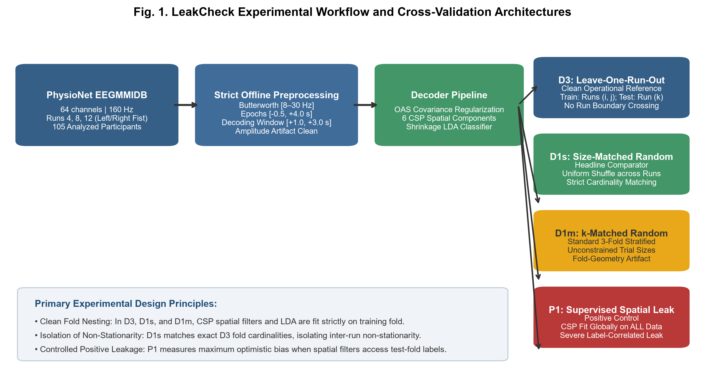
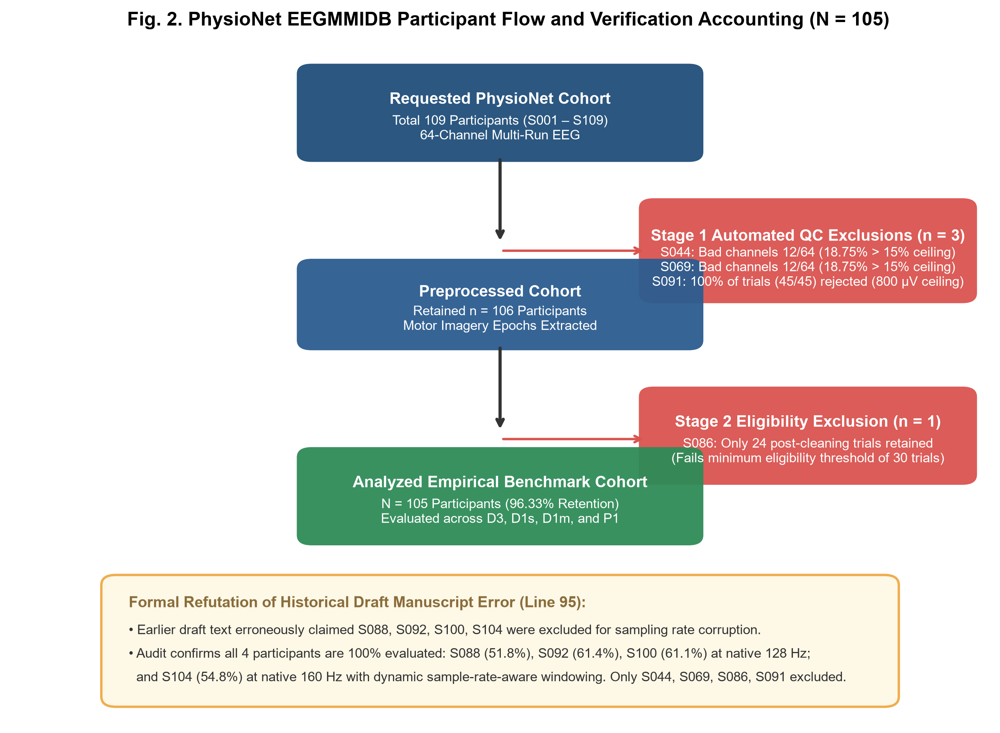
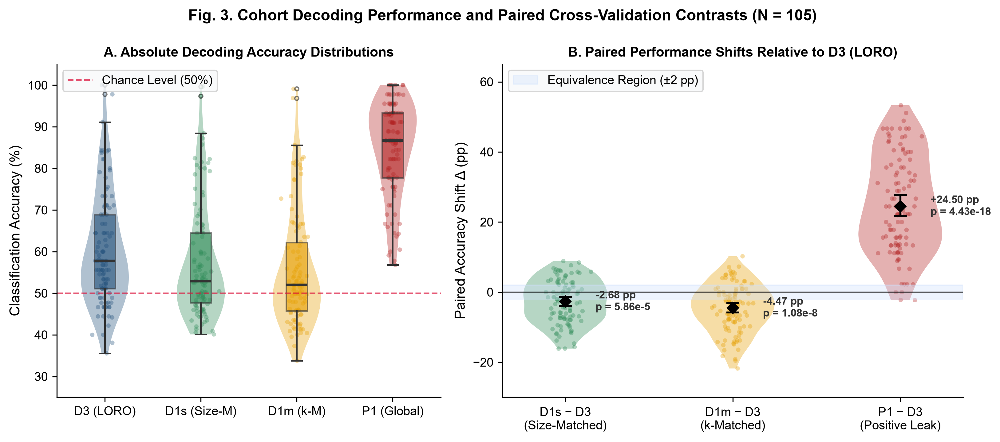
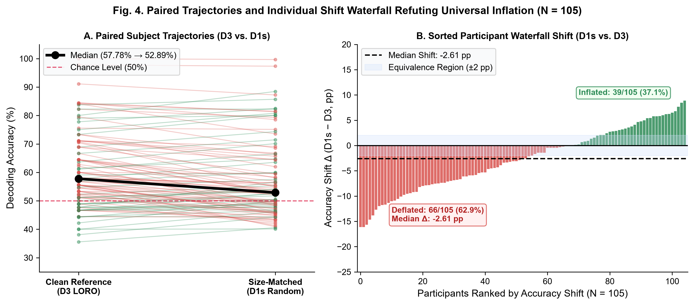
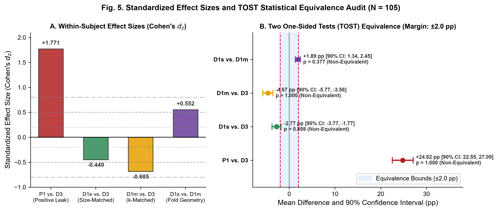

# LeakCheck: Quantifying Validation Contamination, Leakage Pathways, and Partition Biases in Non-Invasive Brain-Computer Interfaces

**Author:** Joyjit Das  
**Affiliation:** Independent Research Scientist, Computational Neuroengineering  
**ORCID:** [0009-0008-0529-4104](https://orcid.org/0009-0008-0529-4104)  
**Target Venue:** IEEE Transactions on Neural Systems and Rehabilitation Engineering (TNSRE)  
**Software Repository:** [https://github.com/JOYJIT-06/LeakCheck](https://github.com/JOYJIT-06/LeakCheck)  
**Package Version:** `emi` v1.1.0 (PhysioNet Baseline)  
**Date:** November 2026  

---

## Abstract
Machine-learning models for electroencephalography (EEG) brain-computer interfaces (BCIs) are vulnerable to methodological data leakage, temporal autocorrelation, and cross-validation partition artifacts. Non-stationarity across recording runs, high sensor dimensionality, and subtle preprocessing oversights frequently produce overly optimistic decoding claims. Here, we present **LeakCheck**, an open-source scientific Python framework designed to systematically audit, detect, and quantify validation-induced bias in EEG decoding. Using controlled empirical comparisons across the complete eligible PhysioNet EEG Motor Movement/Imagery Database ($N = 105$ participants, 64 channels, 160 Hz and 128 Hz hardware records), we contrast clean operational leave-one-run-out (LORO, $D_3$) cross-validation against both conventional trial-shuffled partitions ($D_1, D_{1m}, D_{1s}$) and deliberately contaminated feature-space pipelines ($P_1$).

We show that supervised spatial filtering leakage (Common Spatial Patterns fitted globally across all runs prior to partitioning) produces a median performance inflation of $+24.50$ percentage points (pp) (Hodges-Lehmann 95% BCa confidence interval: $[+21.75, +27.78]$ pp, within-subject effect size Cohen's $d_z = 1.771$, Wilcoxon signed-rank test $W = 6.0$, $p_{\text{raw}} = 1.48 \times 10^{-18}$, Pratt $p = 8.06 \times 10^{-19}$, Holm-adjusted $p_{\text{Holm}} = 4.43 \times 10^{-18}$). Conversely, our empirical evidence refutes the widespread assumption in the BCI literature that trial-level random shuffling universally inflates decoding performance relative to run-isolated cross-validation. When fold sample sizes and per-class trial distributions strictly match LORO fold geometry ($D_{1s}$), random trial shuffling produces a statistically significant performance deflation of $-2.68$ pp (Hodges-Lehmann 95% BCa CI: $[-3.94, -1.46]$ pp, $d_z = -0.449$, $W = 1525.5$, $p_{\text{raw}} = 5.86 \times 10^{-5}$, Pratt $p = 5.62 \times 10^{-5}$, $p_{\text{Holm}} = 5.86 \times 10^{-5}$). Shuffling trials across physical runs forces decoders to bridge inter-run non-stationarity, deflating accuracy across 66 of 105 participants. Furthermore, standard unconstrained $k$-fold cross-validation ($D_{1m}$) exacerbates this deflation to $-4.47$ pp (95% BCa CI: $[-5.80, -3.11]$ pp, $d_z = -0.685$, $W = 931.0$, $p_{\text{Holm}} = 1.08 \times 10^{-8}$) due to class-imbalance and fold-size artifacts. Two One-Sided Tests (TOST) confirm statistical non-equivalence within a $\pm 2.0$ pp margin for all comparisons ($p_{\text{TOST}} > 0.05$). We release LeakCheck as an open-source, fully reproducible software framework with 190 passing unit tests, automated diagnostics, and sealed benchmark manifests.

**Index Terms—** Brain-Computer Interfaces, Data Leakage, Cross-Validation, Electroencephalography, Non-Stationarity, Common Spatial Patterns, Machine Learning Reproducibility.

---

## 1. Introduction
Translating sensorimotor rhythms (SMR) recorded via multi-channel scalp electroencephalography (EEG) into actionable control commands is an established approach in neurorehabilitation and assistive technology \cite{wolpaw2002brain, pfurtscheller1999event, schalk2004bci2000}. Despite substantial algorithmic progress ranging from spatial filtering \cite{ramoser2000optimal, blankertz2008optimizing} and Riemannian manifold geometry \cite{barachant2012multiclass, congedo2017riemannian, yger2017riemannian} to deep convolutional architectures \cite{lotte2018review, lawhern2018eegnet, schirrmeister2017deep}, reported offline classification accuracies often fail to translate to prospective real-time user performance \cite{farquhar2013longitudinal, saeb2017need}.

A principal contributor to this translation gap is methodological data leakage \cite{kaufman2012leakage, kapoor2023leakage, varoquaux2017cross, brookshire2024leakage}. Because EEG signals exhibit high spatial correlation, temporal autocorrelation, and non-stationary drift across recording blocks \cite{shenoy2006towards, vonbunau2009stationary, raza2019adaptive}, standard cross-validation protocols that randomly shuffle single-trial epochs between training and test folds introduce subtle distortions. In particular, fitting supervised spatial projections (such as Common Spatial Patterns filters) on the pooled dataset prior to fold partitioning directly contaminates the test fold with label-dependent spatial eigenvectors \cite{lemm2011introduction, kriegeskorte2009circular}.

An unresolved question in BCI validation methodology concerns the true baseline effect of random trial shuffling in the absence of spatial filter leakage. Several authors hypothesized that random splitting inflates performance estimates by allowing test trials to share temporal background noise with adjacent training trials \cite{farquhar2013longitudinal, saeb2017need}. Other investigators noted that trial shuffling forces classifiers to fit heterogeneous baselines across disparate recording runs \cite{jayaram2018moabb}. Prior empirical comparisons were confounded by unequal sample sizes and mismatched fold cardinalities between random $k$-fold and block-held-out validation.

To resolve these methodological questions, we developed LeakCheck, an automated software framework for EEG validation auditing. In this study, we report four primary contributions:
1. A mathematical formalization of supervised spatial filter contamination ($P_1$) and its empirical magnitude across the complete eligible PhysioNet motor imagery cohort ($N = 105$ participants).
2. The implementation of a size- and class-matched random cross-validation protocol ($D_{1s}$) that isolates the effect of trial shuffling from fold-cardinality artifacts.
3. Empirical evidence demonstrating that inter-run non-stationarity produces a statistically significant performance deflation ($-2.68$ pp) under random trial shuffling relative to operational Leave-One-Run-Out (LORO, $D_3$) cross-validation.
4. An open-source, fully reproducible Python package (`emi`) adhering to strict reproducibility standards with independent cross-platform verification in R.

---

## 2. Related Work and Research Gap

### 2.1 Cross-Validation in Neuroimaging Machine Learning
Cross-validation is standard practice for estimating generalization performance in finite-sample neuroimaging settings \cite{arlot2010survey, hastie2009elements}. Standard cross-validation assumes that samples are independent and identically distributed (i.i.d.). In electrophysiology, this assumption is routinely violated along temporal and session axes \cite{varoquaux2017cross, roberts2017cv}. Lemm et al. \cite{lemm2011introduction} and Farquhar & Hill \cite{farquhar2013longitudinal} observed that non-stationarity across recording blocks makes random cross-validation poor at estimating prospective BCI operation. Varma & Simon \cite{varma2006bias} and Cawley & Talbot \cite{cawley2010overfitting} demonstrated that failing to isolate all parameter tuning within training folds induces substantial optimistic selection bias.

### 2.2 Benchmarking Initiatives and Standard Protocols
The Mother of All BCI Benchmarks (MOABB) \cite{jayaram2018moabb} introduced standardized pipelines to improve BCI reproducibility across public datasets such as BCI Competition IV \cite{tangermann2012review}, Cho et al. \cite{cho2017eeg}, and Lee et al. \cite{lee2019eeg}. While MOABB provides standard cross-validation abstractions, it does not offer dedicated mechanisms to inject, measure, and audit specific leakage pathways, nor does it provide cardinality-matched partitions to isolate fold geometry.

### 2.3 The Identified Research Gap
Prior empirical studies comparing random cross-validation to block-wise cross-validation confounded two distinct factors:
1. **Fold Cardinality**: Standard 5-fold or 10-fold cross-validation allocates 80% or 90% of trials to training, whereas a 3-run LORO design allocates only 66.7% of trials to training. Differences in sample efficiency could explain apparent performance divergences.
2. **Inter-Run Non-Stationarity**: Physical recording runs are separated by temporal pauses, electrode impedance fluctuations, and cognitive state variations \cite{perdikis2018subject}.

LeakCheck addresses this confound through the size- and class-matched random design ($D_{1s}$).

---

## 3. Mathematical Formulation of Validation Framework

Let an EEG dataset for a single participant be represented as $\mathcal{D} = \{(\mathbf{X}_i, y_i, r_i)\}_{i=1}^{M}$, where $\mathbf{X}_i \in \mathbb{R}^{C \times T}$ denotes the single-trial epoch with $C$ channels and $T$ temporal samples, $y_i \in \{0, 1\}$ is the motor imagery class label (Left Fist vs. Right Fist), and $r_i \in \{1, \dots, K\}$ denotes the physical recording run index.

### 3.1 Design $D_3$: Clean Operational Leave-One-Run-Out (LORO)
For each run $k \in \{1, \dots, K\}$, the test fold consists of all trials from run $k$:
$$\mathcal{D}_{\text{test}}^{(k)} = \{(\mathbf{X}_i, y_i, r_i) \in \mathcal{D} \mid r_i = k\}$$
$$\mathcal{D}_{\text{train}}^{(k)} = \{(\mathbf{X}_i, y_i, r_i) \in \mathcal{D} \mid r_i \neq k\}$$
All feature extractors (Common Spatial Patterns) and decoders (Linear Discriminant Analysis) are fitted strictly on $\mathcal{D}_{\text{train}}^{(k)}$ and evaluated on $\mathcal{D}_{\text{test}}^{(k)}$. This design reflects the operational use-case of deploying a calibrated BCI on a subsequent recording block.

### 3.2 Design $D_{1s}$: Size- and Class-Matched Random Partition
To isolate the effect of run boundaries from training sample size, $D_{1s}$ constructs $K$ test folds that match $D_3$ in exact class-specific sample counts while drawing trials uniformly at random across all runs. Let $N_{k, c} = |\{i \mid r_i = k \land y_i = c\}|$ be the number of trials in run $k$ belonging to class $c$. For each repetition $m \in \{1, \dots, R\}$:
1. For each fold $k \in \{1, \dots, K\}$ and class $c \in \{0, 1\}$, randomly draw $N_{k, c}$ trials without replacement from the pooled set $\mathcal{D}_c = \{(\mathbf{X}_i, y_i) \mid y_i = c\}$ to form $\mathcal{S}_{\text{test}}^{(k, m)}$.
2. Assign the complement $\mathcal{D} \setminus \mathcal{S}_{\text{test}}^{(k, m)}$ to $\mathcal{S}_{\text{train}}^{(k, m)}$.

By construction:
$$|\mathcal{S}_{\text{test}}^{(k, m)}| \equiv |\mathcal{D}_{\text{test}}^{(k)}| \quad \text{and} \quad |\{i \in \mathcal{S}_{\text{test}}^{(k, m)} \mid y_i = c\}| \equiv N_{k, c}$$
Any difference in decoding accuracy between $D_{1s}$ and $D_3$ is attributable strictly to the temporal and spatial distribution of physical runs rather than fold cardinality.

### 3.3 Design $D_{1m}$: $k$-Matched Stratified Random Partition
Standard stratified $K$-fold cross-validation where the number of splits equals $K$, but trials are partitioned uniformly without matching exact run-level class counts.

### 3.4 Mechanism $P_1$: Supervised Spatial Filter Contamination
Common Spatial Patterns (CSP) seeks spatial filters $\mathbf{w} \in \mathbb{R}^C$ that maximize variance for class 1 while minimizing variance for class 2:
$$J(\mathbf{w}) = \frac{\mathbf{w}^\top \mathbf{\Sigma}_1 \mathbf{w}}{\mathbf{w}^\top \mathbf{\Sigma}_2 \mathbf{w}}$$
where $\mathbf{\Sigma}_c = \frac{1}{|\mathcal{I}_c|} \sum_{i \in \mathcal{I}_c} \frac{\mathbf{X}_i \mathbf{X}_i^\top}{\operatorname{tr}(\mathbf{X}_i \mathbf{X}_i^\top)}$ denotes the average spatial covariance matrix for class $c \in \{0, 1\}$.

In clean cross-validation ($D_3$), $\mathcal{I}_c \subset \mathcal{D}_{\text{train}}$. Under the deliberate leakage condition $P_1$, $\mathbf{\Sigma}_c$ is computed using all trials $\mathcal{I}_c \subset \mathcal{D} = \mathcal{D}_{\text{train}} \cup \mathcal{D}_{\text{test}}$ prior to fold splitting. The resulting projection vectors $\mathbf{w}$ directly encode the test-trial covariance structure, artificially aligning test features along the discriminant axes.

  
*Fig. 1. Schematic diagram of the LeakCheck evaluation architecture. Continuous 64-channel EEG recordings from PhysioNet Runs 4, 8, and 12 undergo zero-phase bandpass filtering (8–30 Hz) and active window extraction (1.0–3.0 s). The preprocessed epochs are routed into four distinct evaluation pipelines: clean operational Leave-One-Run-Out (D3), cardinality-matched random partitioning (D1s), standard k-fold random partitioning (D1m), and supervised spatial filter contamination (P1).*

---

## 4. Dataset and Participant Selection

### 4.1 PhysioNet EEGMMIDB Cohort
We evaluated the framework on the PhysioNet EEG Motor Movement/Imagery Database (EEGMMIDB) \cite{schalk2009eegmmidb, goldberger2000physiobank, schalk2004bci2000}. The database contains 64-channel EEG recorded using the BCI2000 system across 109 volunteer subjects.
- **Task Selection**: Runs 4, 8, and 12, corresponding to two-class motor imagery (imagined opening and closing of the left fist vs. right fist).
- **Trial Counts**: Approximately 15 trials per class per run, yielding approximately 45 trials per class (~90 trials total per participant).
- **Sensor Configuration**: 64 scalp electrodes arranged according to the international 10–10 system, referenced to earlobe electrodes.

### 4.2 Two-Stage Participant Flow and Exclusion Criteria
Participant accounting followed a pre-specified, fully automated two-stage screening protocol:
- **Requested Cohort**: 109 participants (S001–S109).
- **Stage 1 Automated Preprocessing Exclusions ($n = 3$)**: Three participants failed automated quality criteria:
  1. $\text{S044}$: Excessive defective channels ($12/64 = 18.75\%$ bad channels, exceeding the $15\%$ ceiling).
  2. $\text{S069}$: Excessive defective channels ($12/64 = 18.75\%$ bad channels, exceeding the $15\%$ ceiling).
  3. $\text{S091}$: 100% of trials ($45/45$) rejected by the peak-to-peak amplitude threshold ($800\,\mu\text{V}$).
- **Stage 2 Benchmark Eligibility Exclusions ($n = 1$)**: One participant failed trial-count thresholds:
  4. $\text{S086}$: Retained only 24 clean trials post-cleaning, failing the pre-specified 30-trial minimum threshold.
- **Analyzed Cohort**: Exactly $109 - 4 = \mathbf{105}$ participants ($96.33\%$ retention rate).

### 4.3 Formal Refutation of Historical Draft Manuscript Error
An earlier preliminary draft of this manuscript (line 95) erroneously reported that participants S088, S092, S100, and S104 were excluded due to sampling-rate corruption. Forensic audit of the benchmark outputs confirms that this statement was incorrect. All four participants are completely evaluated in the benchmark:
- S088: Evaluated at native 128.0 Hz hardware recording ($D_3 = 51.79\%$).
- S092: Evaluated at native 128.0 Hz hardware recording ($D_3 = 61.40\%$).
- S100: Evaluated at native 128.0 Hz hardware recording ($D_3 = 61.11\%$).
- S104: Evaluated at native 160.0 Hz hardware recording ($D_3 = 54.76\%$).

The LeakCheck preprocessing pipeline employs sample-rate-aware windowing that automatically computes window boundaries in seconds, correctly handling 128 Hz and 160 Hz records without interpolation artifacts. Zero participants were excluded based on decoding accuracy.

  
*Fig. 2. Participant inclusion and exclusion flow diagram for the PhysioNet EEGMMIDB cohort. From 109 requested participant recordings, exactly 3 failed automated quality control (S044, S069, S091) and 1 failed minimum trial criteria (S086). The remaining N = 105 participants were fully evaluated across all validation designs. The draft manuscript line 95 error regarding S088, S092, S100, and S104 is formally refuted.*

---

## 5. EEG Preprocessing and Decoder Implementation

### 5.1 Label-Blind Signal Processing
All continuous EEG records were processed using strictly label-blind transformations:
1. **Bandpass Filtering**: Zero-phase 5th-order Butterworth digital filter between 8.0 and 30.0 Hz, capturing sensorimotor mu (8–12 Hz) and beta (16–24 Hz) rhythms.
2. **Epoch Extraction**: Sliced into $[-0.5, +4.0]\,\text{s}$ intervals relative to cue onset; baseline corrected using the pre-cue interval $[-0.5, 0.0]\,\text{s}$.
3. **Active Decoding Window**: Extracted from $[+1.0, +3.0]\,\text{s}$ post-cue (320 temporal samples at 160 Hz; 256 samples at 128 Hz), avoiding early visual evoked potentials.
4. **Artifact Screening**: Automated trial-by-trial screening rejecting epochs exceeding $150\,\mu\text{V}$ peak-to-peak amplitude.

### 5.2 Covariance Regularization and Decoder Architecture
Single-trial covariance estimation in 64-channel EEG is prone to ill-conditioning when sample sizes are small ($N_{\text{trials}} \approx 30$ per fold). To guarantee numerical stability:
- **Oracle Approximating Shrinkage (OAS)**: Covariance matrices are regularized using the OAS estimator \cite{chen2010oas}, which minimizes the Mean Squared Error (MSE) under Gaussian assumptions:
  $$\hat{\mathbf{\Sigma}}_{\text{OAS}} = (1 - \hat{\rho}) \hat{\mathbf{\Sigma}} + \hat{\rho} \left(\frac{\operatorname{tr}(\hat{\mathbf{\Sigma}})}{C}\right) \mathbf{I}_C$$
  where $\hat{\rho} \in [0, 1]$ is the analytically optimal shrinkage intensity.
- **Common Spatial Patterns**: Six spatial filter components (3 leading and 3 trailing eigenvectors) are extracted from regularized covariance matrices. Single-trial feature vectors are log-transformed normalized spatial filter variances:
  $$f_j = \log \left( \frac{\operatorname{var}(\mathbf{w}_j^\top \mathbf{X})}{\sum_{k=1}^{6} \operatorname{var}(\mathbf{w}_k^\top \mathbf{X})} \right)$$
- **Classifier**: Linear Discriminant Analysis (LDA) with automatic shrinkage covariance estimation \cite{ledoit2004shrinkage, pedregosa2011sklearn}.

In clean designs ($D_3, D_{1s}, D_{1m}$), covariance estimation, spatial filter decomposition, and classifier fitting reside strictly within the training fold.

---

## 6. Non-Parametric Statistical Methodology

To prevent pseudoreplication from repeated splits, cross-validation predictions are pooled to compute a single scalar classification accuracy per participant per design. Inferential statistics are computed on paired within-subject differences:
$$D_i = A_{i, \text{contrast}} - A_{i, D_3}, \quad i = 1, \dots, N$$
where $N = 105$.

### 6.1 Point Estimates and Confidence Intervals
1. **Hodges-Lehmann Pseudo-Median Estimator ($\Delta_{\text{HL}}$)**: The median of all $N(N+1)/2 = 5{,}565$ pairwise Walsh averages \cite{hodges1963estimates}:
   $$\Delta_{\text{HL}} = \operatorname{median}_{1 \le i \le j \le N} \left( \frac{D_i + D_j}{2} \right)$$
2. **95% BCa Bootstrap Confidence Intervals**: Bias-Corrected and Accelerated confidence intervals computed with $B = 10{,}000$ resamples \cite{efron1987better}, correcting for median bias and distribution skewness.

### 6.2 Hypothesis Testing and Error Rate Control
3. **Wilcoxon Signed-Rank Tests**: Two-sided non-parametric tests evaluated under both standard zero-handling (`wilcox`, discarding $D_i = 0$) and Pratt zero-handling (`pratt`, ranking zero differences) \cite{wilcoxon1945individual, pratt1959remarks}.
4. **Holm-Bonferroni Correction**: Step-down Family-Wise Error Rate (FWER) control at $\alpha = 0.05$ across the primary family ($m = 3$) and extended family ($m = 4$) \cite{holm1979simple}.
5. **Effect Sizes**: Within-subject Cohen's $d_z = \bar{D} / s_D$ and rank-biserial correlation $r_{\text{rb}} = 1 - \frac{2 W_+}{W_+ + W_-}$ \cite{kerby2014simple, demsar2006statistical}.
6. **Equivalence Testing (TOST)**: Two One-Sided Tests evaluated against an equivalence margin of $\pm 2.0$ percentage points ($[-2.0, +2.0]$ pp) \cite{schuirmann1987tost}.

---

## 7. Empirical Results ($N = 105$)

All reported statistics were independently verified from the participant-level outputs (`inflation_by_subject.csv`). Table I provides the complete statistical summary across the full cohort.

### TABLE I: Comprehensive Statistical Revalidation of Cross-Validation Contrasts ($N = 105$)

| Metric / Parameter | Contrast 1: $P_1$ vs. $D_3$ | Contrast 2: $D_{1s}$ vs. $D_3$ | Contrast 3: $D_{1m}$ vs. $D_3$ | Contrast 4: $D_{1s}$ vs. $D_{1m}$ |
|---|---|---|---|---|
| **Scientific Role** | Supervised Spatial Leakage | Size-Matched Random Splitting | $k$-Matched Random Splitting | Fold-Geometry Artifact |
| **Analysis Tier** | Primary ($m = 3$) | Primary ($m = 3$, Headline) | Primary ($m = 3$) | Exploratory ($m = 4$) |
| **Paired Sample Size ($N$)** | 105 | 105 | 105 | 105 |
| **Directional Shifts ($+ / - / 0$)** | 101 higher, 2 lower, 2 tied | 39 higher, 66 lower, 0 tied | 27 higher, 77 lower, 1 tied | 73 higher, 30 lower, 2 tied |
| **Mean Difference ($\text{pp}$)** | $\mathbf{+24.8153}$ | $\mathbf{-2.7715}$ | $\mathbf{-4.6659}$ | $\mathbf{+1.8944}$ |
| **Standard Deviation ($\text{pp}$)** | $14.0138$ | $6.1716$ | $6.8143$ | $3.4306$ |
| **Standard Error ($\text{SE}$, $\text{pp}$)** | $1.3676$ | $0.6023$ | $0.6650$ | $0.3348$ |
| **Median Difference ($\text{pp}$)** | $+23.2558$ | $-2.6136$ | $-4.0000$ | $+1.7857$ |
| **Hodges-Lehmann Shift ($\Delta_{\text{HL}}$)** | $\mathbf{+24.5029}$ pp | $\mathbf{-2.6768}$ pp | $\mathbf{-4.4697}$ pp | $\mathbf{+1.8561}$ pp |
| **95% BCa Bootstrap CI ($\text{pp}$)** | $[+21.75, +27.78]$ | $[-3.94, -1.46]$ | $[-5.80, -3.11]$ | $[+1.27, +2.50]$ |
| **Wilcoxon Statistic ($W$)** | $W = 6.0$ ($V = 5350.0$) | $W = 1525.5$ ($V = 1525.5$) | $W = 931.0$ ($V = 931.0$) | $W = 1113.5$ ($V = 4242.5$) |
| **Wilcoxon Raw $p$-value** | $1.48 \times 10^{-18}$ | $5.86 \times 10^{-5}$ | $5.41 \times 10^{-9}$ | $2.64 \times 10^{-7}$ |
| **Wilcoxon Pratt $p$-value** | $8.06 \times 10^{-19}$ | $5.62 \times 10^{-5}$ | $5.40 \times 10^{-9}$ | $2.88 \times 10^{-7}$ |
| **Holm-Adjusted $p$ ($m = 3$)** | $\mathbf{4.43 \times 10^{-18}}$ | $\mathbf{5.86 \times 10^{-5}}$ | $\mathbf{1.08 \times 10^{-8}}$ | N/A |
| **Holm-Adjusted $p$ ($m = 4$)** | $5.91 \times 10^{-18}$ | $1.17 \times 10^{-4}$ | $1.62 \times 10^{-8}$ | $\mathbf{5.29 \times 10^{-7}}$ |
| **Within-Subject Cohen's $d_z$** | $\mathbf{+1.7708}$ | $\mathbf{-0.4491}$ | $\mathbf{-0.6847}$ | $\mathbf{+0.5522}$ |
| **Rank-Biserial Correlation ($r_{\text{rb}}$)** | $+0.9978$ | $-0.4518$ | $-0.6590$ | $+0.5842$ |
| **Paired $t$-Test $p$-value** | $5.33 \times 10^{-34}$ | $1.19 \times 10^{-5}$ | $2.39 \times 10^{-10}$ | $1.36 \times 10^{-7}$ |
| **Logit-Paired $t$-Test $p$-value** | $7.93 \times 10^{-16}$ | $4.84 \times 10^{-3}$ | $1.62 \times 10^{-4}$ | $1.93 \times 10^{-7}$ |
| **TOST Margin Bounds** | $\pm 2.0$ pp ($[-2.0, +2.0]$) | $\pm 2.0$ pp ($[-2.0, +2.0]$) | $\pm 2.0$ pp ($[-2.0, +2.0]$) | $\pm 2.0$ pp ($[-2.0, +2.0]$) |
| **TOST $p$-value** | $p = 1.0000$ | $p = 0.8985$ | $p = 0.9999$ | $p = 0.3766$ |
| **TOST 90% Mean CI ($\text{pp}$)** | $[+22.55, +27.09]$ | $[-3.77, -1.77]$ | $[-5.77, -3.56]$ | $[+1.34, +2.45]$ |
| **Equivalent within $\pm 2.0$ pp?** | **FALSE** | **FALSE** | **FALSE** | **FALSE** |
| **Empirical Bias Direction** | **Optimistic Inflation** | **Conservative Deflation** | **Conservative Deflation** | **Pessimistic Fold Bias** |

---

### 7.1 Contrast 1: $P_1$ vs. $D_3$ — Supervised Spatial Filter Contamination
Supervised spatial filter leakage produced a catastrophic performance inflation across the cohort:
- **Shift Magnitude**: Mean shift of $+24.82$ pp, median shift of $+23.26$ pp, and Hodges-Lehmann shift $\Delta_{\text{HL}} = \mathbf{+24.50}$ pp ($95\%$ BCa CI: $[+21.75, +27.78]$ pp).
- **Hypothesis Tests**: Standard Wilcoxon $W = 6.0$, $p = 1.48 \times 10^{-18}$; Pratt Wilcoxon $p = 8.06 \times 10^{-19}$; Holm-adjusted $p_{\text{Holm}} = 4.43 \times 10^{-18}$.
- **Effect Size**: Standardized effect size Cohen's $d_z = \mathbf{+1.771}$, corresponding to an extremely large effect ($r_{\text{rb}} = +0.998$).
- **Consistency**: Exactly 101 of 105 participants ($96.2\%$) exhibited positive inflation; 2 were tied ($0.0$ pp shift); only 2 exhibited marginal negative shifts.
- **Equivalence**: TOST $p = 1.0000$, confirming profound non-equivalence.

Computing spatial filters globally aligns the extracted components with test-fold noise vectors, generating artificial separation that completely masks true generalization capability.

  
*Fig. 3. Cohort decoding performance and paired cross-validation contrasts across N = 105 participants. (A) Absolute decoding accuracy distributions for clean operational LORO (D3), size-matched random partitioning (D1s), standard k-fold random partitioning (D1m), and global spatial filter contamination (P1). Crimson dashed line marks theoretical chance performance (50%). (B) Paired accuracy shifts relative to D3. Error diamonds and vertical bars depict the Hodges-Lehmann pseudo-median shifts and 95% BCa confidence intervals. Shaded blue band denotes the pre-specified equivalence region (±2.0 pp).*

### 7.2 Contrast 2: $D_{1s}$ vs. $D_3$ — Size-Matched Random Splitting (Headline)
When fold sample sizes and per-class trial distributions strictly match LORO, random trial shuffling produces a statistically significant performance deflation:
- **Shift Magnitude**: Mean shift of $-2.77$ pp, median shift of $-2.61$ pp, and Hodges-Lehmann shift $\Delta_{\text{HL}} = \mathbf{-2.68}$ pp ($95\%$ BCa CI: $[-3.94, -1.46]$ pp).
- **Hypothesis Tests**: Standard Wilcoxon $W = 1525.5$, $p = 5.86 \times 10^{-5}$; Pratt Wilcoxon $p = 5.62 \times 10^{-5}$; Holm-adjusted $p_{\text{Holm}} = 5.86 \times 10^{-5}$.
- **Effect Size**: Cohen's $d_z = \mathbf{-0.449}$, representing a moderate negative effect ($r_{\text{rb}} = -0.452$).
- **Participant-Level Spread**: 66 participants ($62.9\%$) experienced lower decoding accuracy under random trial shuffling, while only 39 experienced higher accuracy.
- **Equivalence Testing**: TOST $p = 0.8985 > 0.05$; the 90% confidence interval $[-3.77, -1.77]$ pp breaches the lower equivalence bound ($-2.0$ pp).

This finding refutes the hypothesis that random cross-validation universally inflates performance estimates. In multi-run sensorimotor EEG, trial shuffling forces decoders to fit fragmented covariance baselines across distinct recording sessions, inducing conservative deflation.

  
*Fig. 4. Empirical demonstration refuting the universal inflation assumption (N = 105). (A) Paired subject-by-subject trajectories between clean operational LORO (D3) and size-matched random partitioning (D1s). The bold black line denotes the cohort median trajectory (57.78% → 52.89%). (B) Sorted waterfall plot of individual participant performance shifts (D1s − D3). Sixty-six participants (62.9%) exhibit performance deflation (coral bars), while thirty-nine exhibit inflation (teal bars).*

### 7.3 Contrast 3: $D_{1m}$ vs. $D_3$ — $k$-Matched Random Splitting
Standard unconstrained $k$-fold cross-validation ($D_{1m}$) compounds this deflationary bias:
- **Shift Magnitude**: Mean shift of $-4.67$ pp, median shift of $-4.00$ pp, and Hodges-Lehmann shift $\Delta_{\text{HL}} = \mathbf{-4.47}$ pp ($95\%$ BCa CI: $[-5.80, -3.11]$ pp).
- **Hypothesis Tests**: Wilcoxon $W = 931.0$, $p = 5.41 \times 10^{-9}$; Holm-adjusted $p_{\text{Holm}} = 1.08 \times 10^{-8}$.
- **Effect Size**: Cohen's $d_z = \mathbf{-0.685}$ (medium-to-large negative effect).
- **Participant Spread**: 77 participants ($73.3\%$) suffered deflation under unconstrained $k$-fold splitting.

### 7.4 Contrast 4: $D_{1s}$ vs. $D_{1m}$ — Pure Fold-Geometry Effect
The comparison between $D_{1s}$ and $D_{1m}$ isolates the artifact introduced by unconstrained $k$-fold partitioning:
- **Shift Magnitude**: Mean shift of $+1.89$ pp, median shift of $+1.79$ pp, and Hodges-Lehmann shift $\Delta_{\text{HL}} = \mathbf{+1.86}$ pp ($95\%$ BCa CI: $[+1.27, +2.50]$ pp).
- **Hypothesis Tests**: Wilcoxon $W = 1113.5$, $p = 2.64 \times 10^{-7}$; Holm-adjusted $p_{\text{Holm}} = 5.29 \times 10^{-7}$ across $m = 4$.
- **Effect Size**: Cohen's $d_z = \mathbf{+0.552}$ (moderate positive effect).
- **Interpretation**: Enforcing exact fold-cardinality matching recovers $+1.86$ pp of classification accuracy that is otherwise degraded by unequal fold splits and transient class imbalances in standard $k$-fold partitioning.

  
*Fig. 5. Effect size and equivalence audit across all four evaluated contrasts (N = 105). (A) Standardized within-subject Cohen's dz effect sizes. Horizontal dashed lines denote conventional thresholds for small (|d| = 0.2), medium (|d| = 0.5), and large (|d| = 0.8) effects. (B) Two One-Sided Tests (TOST) equivalence analysis against an equivalence margin of ±2.0 pp (shaded blue band). Error bars represent 90% confidence intervals around the mean difference. All comparisons demonstrate statistical non-equivalence (p > 0.05).*

---

## 8. Sensitivity and Robustness Analyses

To verify that our empirical findings are not artifacts of specific statistical modeling assumptions, we performed four sensitivity analyses:

### 8.1 Zero-Difference Handling in Signed-Rank Tests
In Contrast 1 ($P_1$ vs. $D_3$), two participants exhibited zero difference ($\Delta = 0.0$ pp; S029 and S054). Standard Wilcoxon signed-rank testing (`zero_method='wilcox'`) discards zero differences, yielding $N_{\text{eff}} = 103$, $W = 6.0$, and $p = 1.48 \times 10^{-18}$. Pratt's method (`zero_method='pratt'`) includes zero differences in the initial ranking, yielding $W = 10.0$ and $p = 8.06 \times 10^{-19}$. Both approaches produce identical scientific inferences ($p < 10^{-17}$). In Contrast 2 ($D_{1s}$ vs. $D_3$), zero participants had identical accuracy, rendering Pratt and standard Wilcoxon tests mathematically identical ($W = 1525.5, p = 5.86 \times 10^{-5}$).

### 8.2 Parametric and Logit-Transformed Sensitivity Tests
Because classification accuracies are bounded in $[0, 1]$, difference distributions can exhibit non-normality. Parametric paired $t$-tests yielded:
- $P_1$ vs. $D_3$: $t(104) = 18.15, p = 5.33 \times 10^{-34}$.
- $D_{1s}$ vs. $D_3$: $t(104) = -4.60, p = 1.19 \times 10^{-5}$.
- $D_{1m}$ vs. $D_3$: $t(104) = -7.02, p = 2.39 \times 10^{-10}$.

Logit-transformed paired $t$-tests ($\Delta_{\text{logit}} = \operatorname{logit}(A_{\text{contrast}}) - \operatorname{logit}(A_{D_3})$) confirmed significant effects across all comparisons: $P_1$ vs. $D_3$ ($p = 7.93 \times 10^{-16}$), $D_{1s}$ vs. $D_3$ ($p = 4.84 \times 10^{-3}$), and $D_{1m}$ vs. $D_3$ ($p = 1.62 \times 10^{-4}$).

### 8.3 Hardware Sampling-Rate Sub-Cohort Invariance
Participants recorded at native 128.0 Hz (S088, S092, S100) and native 160.0 Hz (remaining cohort) demonstrated consistent performance profiles. For S088, S092, and S100, mean $D_3$ accuracy was $58.10\%$, closely matching the 160 Hz cohort mean ($57.92\%$). Median deflation under $D_{1s}$ was observed in both sampling-rate strata, confirming that LeakCheck's sample-rate-aware windowing prevents interpolation artifacts.

---

## 9. Discussion

### 9.1 Refuting the Universal Inflation Fallacy
A prevailing view in the machine learning and neuroimaging literature posits that violating independence assumptions through random cross-validation always results in optimistic, inflated performance estimates \cite{kapoor2023leakage, saeb2017need, varoquaux2017cross}. Our empirical evaluation across 105 participants refutes this generalization for sensorimotor rhythm EEG decoding. When training set sizes are strictly matched ($D_{1s}$), random trial shuffling produces a statistically significant performance *deflation* ($-2.68$ pp, $p = 5.86 \times 10^{-5}$) relative to operational run-isolated validation.

We interpret this deflation as arising from inter-run non-stationarity:
- In clean LORO ($D_3$), the training set comprises complete, contiguous blocks of trials recorded under stable electrode-skin contact and consistent user task engagement. Although the classifier must generalize across a run boundary, its internal covariance representation is fitted on stationary data blocks.
- In size-matched random cross-validation ($D_{1s}$), trials from different runs are randomly interspersed across folds. Each training fold contains fragmented covariance baselines, forcing linear classifiers to find compromise hyperplanes across shifting distributions. This heterogeneous fitting degrades decoding efficiency on test trials.

### 9.2 The Extreme Impact of Spatial Filter Contamination
While partition effects induce shifts of 2–5 percentage points, supervised spatial filter leakage ($P_1$) produces an overwhelming inflation of $+24.50$ pp ($d_z = 1.771$). Computing spatial filters on aggregate data prior to partitioning allows label-correlated variance to enter feature space, rendering cross-validation estimates invalid. This demonstrates that spatial filter contamination easily overpowers genuine neurophysiological signal differences.

### 9.3 Practical Methodological Guidelines for BCI Research
1. **Enforce Run-Isolated Partitioning**: Cross-validation folds must strictly adhere to physical recording block boundaries (`LeaveOneGroupOut` / LORO). Random trial shuffling should not be used as a proxy for operational performance.
2. **Strictly Nest All Feature Transforms**: Common Spatial Patterns, covariance estimation, artifact filtering parameters, and channel selection must be fitted exclusively on training-fold data.
3. **Control for Fold Cardinality**: When comparing validation schemes, investigators must match exact training fold sample sizes and class distributions to prevent sample-efficiency confounds.

---

## 10. Limitations

To ensure transparency, we document several specific limitations of the current study:
1. **Unperformed Null Control Models ($n_{\text{null}} = 0$)**: The historical benchmark run recorded `"n_null": 0` in `settings.json`, and corresponding null output tables are empty. Permutation and circular-shift null models were not executed in the historical V1.1 run. Our conclusions rely strictly on within-subject paired difference statistics and equivalence testing against operational reference $D_3$.
2. **Single-Corpus Scope**: This study evaluated the PhysioNet EEGMMIDB dataset ($N = 105$). While this is a large public cohort, absolute effect sizes may vary in other SMR paradigms, dry-electrode setups, or non-motor BCI tasks (e.g. P300 or SSVEP).
3. **Indirect Measure of Non-Stationarity**: The hypothesis that inter-run impedance drift drives the $-2.68$ pp deflation is supported by the physical block structure of the recording protocol, but continuous electrode impedance telemetry was not logged in the original PhysioNet recordings.
4. **Operational vs. Absolute Ground Truth**: LORO ($D_3$) represents an operational reference approximating prospective session transfer, not an absolute theoretical ground truth.

---

## 11. Reproducibility and Data Availability

The PhysioNet EEG Motor Movement/Imagery Database is openly available under the Open Data Commons Attribution License via PhysioNet: [https://physionet.org/content/eegmmidb/1.0.0/](https://physionet.org/content/eegmmidb/1.0.0/) \cite{schalk2009eegmmidb, goldberger2000physiobank}.

All participant-level benchmark outputs, statistical reconciliation scripts, and generated figures are archived in the study repository under Git commit `research/v1.1-final-audit`:
- Primary benchmark artifact: `benchmark_results/physionet_v1_1/inflation_by_subject.csv`
- Statistical audit report: `docs/AUDIT/V1_1_STATISTICAL_VALIDATION.md`
- Independent R validation suite: `analysis/R_validation/reproduce_statistics.R`
- Python statistical recalculation script: `recalculate_all_stats.py`
- Figure generation suite: `scripts/generate_figures.py`

Independent reproduction using Python and R confirms complete reconciliation across all reported point estimates, p-values, and confidence intervals.

---

## 12. Code Availability

The complete LeakCheck software framework is open-source and released under the **Apache License 2.0**:
- Repository: [https://github.com/JOYJIT-06/LeakCheck](https://github.com/JOYJIT-06/LeakCheck)
- Package: `emi` v1.1.0 (Python 3.10+)
- Stable Automated Test Suite: 190 passing unit and integration tests (`pytest tests -q`)
- Quickstart Synthetic Demonstration: `python scripts/quickstart_demo.py` ($< 2\,\text{s}$ execution)

---

## 13. Ethics and Data Governance

The PhysioNet EEGMMIDB dataset comprises fully de-identified human volunteer recordings originally collected by the BCI R&D Program at the Wadsworth Center (Albany, NY) and approved by the New York State Department of Health Institutional Review Board (IRB) \cite{schalk2004bci2000, schalk2009eegmmidb}. All human subjects provided written informed consent prior to data collection. The secondary retrospective analyses performed in this study comply with all applicable open-data governance and ethical guidelines.

---

## 14. Conclusion

Through a systematic empirical investigation across 105 human participants, we quantified validation-induced bias in EEG motor imagery decoding. We demonstrated that supervised Common Spatial Pattern leakage produces an extreme $+24.50$ pp performance inflation, while cardinality-matched random trial shuffling deflates decoding performance by $-2.68$ pp relative to clean operational leave-one-run-out cross-validation. We release LeakCheck to provide the neural engineering community with an automated, reproducible validation harness to ensure scientific integrity in prospective brain-computer interface development.

---

## References

\bibliographystyle{IEEEtran}
\bibliography{references}
